# Stopping training when the features stop moving: the F2 study

*Final report, 2026-11-15. It is written to be read with no prior knowledge of the
project. Every number in it is in [tables/summary.csv](tables/summary.csv) and
[tables/numbers.txt](tables/numbers.txt), and [make_figures.py](make_figures.py)
regenerates all figures and tables from the raw outputs. The earlier technical write-up
is in [detailed/](detailed/REPORT_detailed.md).*

## In one paragraph

We want a rule that stops training once a network has finished learning, using only the
training data, and that does not quit too early on tasks where the network "groks", that
is, generalizes long after it has fit its training data. The idea tested here, called
**F2**, watches the network's learned features, measured with the *average gradient
outer product* (AGOP), and stops when they stop moving.

We built five online versions of F2 and tuned each one on one set of training runs. We
then scored them on 224 recorded runs they had not been tuned on, against the simplest
competitor: stop at a fixed fraction of the training budget.

- **Modular arithmetic.** F2 roughly halves the cost of training to the end. It almost
  never cuts off a grokking run, while the fixed fraction cuts off up to half of them.
  On average, though, it ties with the fixed fraction.
- **MNIST.** F2 loses to the fixed fraction. Even an oracle that knows the final features
  does no better than training to the end, because on MNIST the features keep changing
  long after test accuracy has settled.

---

## 1. What the AGOP is

Take a network f that maps an input x (d numbers) to an output (c numbers). Its **input
Jacobian** J(x) is the c × d matrix of derivatives ∂fᵢ/∂xⱼ. It says how much each output
moves when each input coordinate is nudged.

Mallinar et al. (*Emergence in non-neural models: grokking modular arithmetic via average
gradient outer product*, 2024, Definition 2.1) define the **AGOP** over the n training
inputs as

> **G = (1/n) Σᵢ J(xᵢ)ᵀ J(xᵢ)**, a d × d matrix.

**What it measures.** For any input direction u, uᵀGu is the average squared change of
the output when every training input is nudged along u. So:

- directions with large uᵀGu are the ones the network is sensitive to;
- the top eigenvectors of G are the input patterns the network has learned to use, i.e.
  its **features**;
- directions that G ignores are ones the network has learned to disregard.

**Why it is "the features" of an MLP.** For the first layer W₁, G is W₁ᵀW₁ seen through
the rest of the network. Empirically, W₁ᵀW₁ tracks G^{1/2} (the "neural feature ansatz"
of Radhakrishnan et al.). So Mallinar et al. call **M = G^{1/2} the feature matrix**.

**AGOP alignment.** Mallinar et al. track how far the features are from their final form
with

> alignment(t) = cos(M_t, M_final) = ⟨M_t, M_final⟩ / (‖M_t‖ ‖M_final‖),

where M_final is the feature matrix at the end of training. On modular arithmetic they find
that the alignment climbs steadily while test accuracy is still at chance, and reaches 1
when the network generalizes. It is a "hidden progress measure". But it needs M_final, the
end of training, so it cannot be used to decide *when* to end training.

## 2. From AGOP alignment to an online signal

The question is how to turn "the features have reached their final form" into something
that can be checked during training, from the training data alone.

**Requirements.**

- **Causal.** At step t the rule may use only the weights at steps ≤ t and the training
  data. It never sees test data.
- **Grokking-safe.** On a grokking plateau the training loss is flat while the features
  are still forming. A rule that watches the loss stops there, and so would a rule that
  only checks whether anything has moved recently. The rule has to watch the features
  themselves.
- **No hidden units.** Learning rates in our runs span 10⁻⁴ to 1, and weight sizes change
  by large factors during training. The signal must not depend on either.

**The derivation, step by step.**

1. **The object.** At step t, compute G_t on the training set from the current weights,
   and take M_t = G_t^{1/2}.
2. **Keep only the shape.** The size of M carries no feature information: it grows or
   shrinks with the weights. So we normalize, M̂_t = M_t / ‖M_t‖, and measure the
   distance between two feature states by the **angle** between them, in radians.
   Mallinar's alignment is the cosine of the angle to the final features.
3. **What "done" means.** Done means the angle from M̂_t to M̂_final is small. M̂_final
   is in the future, so any online estimate of that angle is a prediction.
4. **Trade "where" for "how much more".** Angles obey the triangle inequality, so the
   direct angle from now to the end is at most the total angle the features will still
   travel. We no longer need to know *where* the features are going, only *how much more
   they will move*. This holds for any path, including turns and detours.
5. **Measure recent motion causally.** The angle between the features now and the
   features some lag ago is observable. To reduce noise we compare averages of a few
   neighbouring evaluation points, not single points.
6. **From recent motion to future motion.** There are two ways to proceed.
   - **(a) Extrapolate.** Near the end of training the motion typically slows down
     exponentially. If it slows by a factor q per lag, the remaining motion is a
     geometric series, θ·q/(1 − q), where θ is the angle over the last lag. This is the
     **remaining-angle bound**. When the motion is not slowing down, the bound is
     infinite and the rule waits, which is the safe failure. Measuring the lag as a
     fixed share of the steps so far makes the bound independent of the learning rate.
   - **(b) Don't extrapolate.** Our pilot on 61 runs showed that (a) often stops too early.
     Right after the network fits its training data the motion slows sharply, so the
     extrapolation says "almost done", but a slow drift that carries most of the
     remaining feature change still follows. The alternatives are to require that recent
     motion be small, without predicting it, or to test statistically whether the
     features are still *drifting somewhere* or only *jittering in place*.

The five variants in section 3 are the concrete versions of 6(a) and 6(b).

**A note on the earlier proposal.** A proposal we reviewed estimates the alignment online
by assuming that the AGOP moves in a straight line from the moment of memorization, at
an exponentially slowing speed. In a simulated grokking path it stopped on the plateau,
far too early, unless a straightness check was added. Step 4 above removes the need for
any assumption about the path's shape, which is why we took this route instead
([AGOP.md](../AGOP.md) §2–5).

## 3. The online variants we tried

Each variant computes one number per evaluation point and stops when that number passes
a threshold. The variants differ in what the number is.

**Knobs shared by the variants:**

| Knob | Options | Why it is there |
|---|---|---|
| **What is watched** (all five) | M (the feature matrix, G^{1/2}); G (the AGOP itself); W (the direction of each layer's weight matrix; *every* layer must pass) | M is the paper's choice. G weights strong features more. W asks whether the whole network has settled, not just the input features. |
| **Smoothing** (A–C; D and E work on a whole trailing window instead) | single evaluation points; averages of 3 neighbouring points; averages of 3 with the noise floor removed | Minibatch training (MNIST) makes the weights jitter. Averaging, plus subtracting the spread within the window, keeps jitter from looking like motion. |
| **Norm gate** | off; on | The angle ignores the weights' overall size. With the gate on, the rule also requires the logarithm of the total weight norm to have stopped changing by the same criterion, so a network still shrinking under weight decay is not called settled. |
| **Patience** | fixed at 3 | The condition must hold at 3 consecutive evaluation points. |

**The five variants:**

| | Name | The number it computes | Variant-specific knobs | Settings |
|---|---|---|---|---|
| **F2-A** | Extrapolated rotation (the remaining-angle bound) | Predicted total rotation still to come, θ·q/(1 − q), where θ is the angle over the last lag and q is how much the motion slowed between the last two lags. Stop when it is below a threshold. | lag = 15%, 25% or 33% of the steps so far; slow-down rate estimated from the last two lags or from a regression of log speed over [t/2, t]; threshold 0.03, 0.1 or 0.3 rad; norm gate threshold 0.05 | 324 |
| **F2-B** | Rotation over a growing window | The angle between the features now and the features a lag ago, with the lag a fixed share of the steps so far. Stop when it is small. This is F2-A without the extrapolation. | lag = 15%, 25% or 33% of the steps so far; threshold 0.003, 0.01, 0.03, 0.1 or 0.3 rad | 270 |
| **F2-C** | Rotation over a fixed window | The same angle, but with a lag that is a fixed share of the training *budget*: Δ = 0.5%, 1%, 2%, 5% or 10% of the budget. The simplest version of F2. It needs the budget, as the fixed fraction does. | lag (5 values); threshold (same 5 values as F2-B); smoothing limited to single points or averages of 3 with the noise floor removed | 300 |
| **F2-D** | Drift test (mean-squared displacement) | Over the trailing window [t/f, t], how the squared distance between two points grows with the time between them: as time² for steady drift, as time for a random walk, not at all for jitter around a point. The exponent of that growth is the statistic; stop when it is small (settled). | window factor f = 2 or 4; stop when the exponent ≤ 0.5 or ≤ 1 | 24 |
| **F2-E** | Early-vs-late test (Geweke's diagnostic, borrowed from MCMC) | Split the trailing window [t/f, t] into an early and a late part. Measure the distance between their average features in units of their standard errors (≈ 1 for jitter, large for a drift). Stop when it is small. | window factor f = 2 or 4; stop when the statistic ≤ 2, 5 or 20 | 36 |

Each variant's settings are every combination of its own knobs with the shared ones:
three watched objects, the smoothing options, and the norm gate on or off. That gives
954 F2 settings in total. Tuning (section 8) picks one setting per variant.

## 4. The data: 224 recorded training runs

We did not train new networks for this study. We replayed runs from a corpus trained
earlier for the project (1,088 runs: 832 modular, 256 MNIST) and picked 224 of them.

### 4.1 The two tasks

| | Modular arithmetic (160 runs) | MNIST digits (64 runs) |
|---|---|---|
| Task | Given a and b in {0, …, 96}, predict (a + b), (a × b) or (a ÷ b) mod 97. The input is the two numbers one-hot encoded (194 inputs); the output is one of 97 classes. | Classify 28 × 28 handwritten digits (784 inputs, 10 classes). |
| Training set | A random 30%, 50% or 70% of all 97 × 97 pairs for x + y; 50% for x × y and x ÷ y | A fixed random subset of the 60,000 training images: 1,000 for the 3-layer network, 4,000 for the 8-layer one |
| Test set | All remaining pairs | The full 10,000-image test set |
| Network | MLP, 3 layers, width 512, ReLU | MLP, 3 layers × width 200, or 8 layers × width 400, ReLU |
| Loss, batch | Cross-entropy, full batch | Squared error, batches of 200 |
| Budget | 100,000 steps | 100,000 steps |
| Classic behaviour | Grokking: fits the training set early, generalizes much later or never | Gradual learning; grokking-like delays appear with large initial weights |

### 4.2 The hyperparameters that vary between runs

| Hyperparameter | Modular | MNIST |
|---|---|---|
| Optimizer | AdamW, Adam with L2 penalty, SGD, SGD with momentum 0.9 | the same four |
| Learning rate | 1e-3 (Adam family), 1 (SGD), 0.3 (SGD + momentum) | 1e-3 (Adam family); SGD family 0.01–0.1, or 1e-4 for some 8-layer settings |
| Weight decay | 4 levels per optimizer, from 0 up to 1 (AdamW) | 4 levels per optimizer, from 0 up to 0.1 |
| Initial weight scale | ×1, ×2 or ×4 (×1 or ×4 for x × y, x ÷ y) | ×1, ×2, ×4 or ×8 |
| Train-set size | 30%, 50%, 70% (x + y only) | fixed per network |
| Random seed | 4 seeds per setting | 4 seeds per setting |

These grids were fixed before this study. Learning rates came from a stability scan, and
weight-decay levels were chosen so that grokking happens at times spread across the
budget. The full grids are in `configs/sweeps/phase3_modular.yaml` and
`phase3_mnist.yaml`, and [tables/corpus.csv](tables/corpus.csv) lists the values that
appear in the 224 runs.

### 4.3 How the 224 runs were chosen

- **Unit of choice: a setting, with all 4 seeds.** A setting is one combination of the
  hyperparameters above. We chose whole settings and always took all four seeds, so that
  the new-seeds test (section 8) has the same settings on both sides.
- **How many settings.**
  - Modular: 24 settings of x + y (6 per optimizer) and 8 each of x × y and x ÷ y (2 per
    optimizer): 40 settings, 160 runs.
  - MNIST: 8 settings each of the 3-layer and 8-layer networks (2 per optimizer): 16
    settings, 64 runs.
- **Covering every behaviour.** Within each (task variant, optimizer), the settings were
  picked in turn from each outcome type seen on seed 0: fast, grokking, never learning,
  and so on. This makes every behaviour appear, not just the common ones.
- **Exclusions.** Diverged runs were excluded.

### 4.4 What was measured on each run

- **Replay.** Each run was replayed from its saved snapshots, which were taken every
  10,000 steps.
- **Replay check.** Every replay was verified against the original recording: the same
  predictions on ≥ 99.9% of training examples, and the same weights to within a relative
  error of 10⁻⁶. 188 runs were replayed for this study. The other 36 were reused from an
  earlier experiment with identical settings. No run failed.
- **Evaluation points.** At 223 points per run (150 spread evenly on a log scale of
  steps, 150 spread evenly in steps) we computed, on the full training set:
  - G;
  - M;
  - every layer's weight direction;
  - the angle between each of these and its value at every earlier point.
  For MNIST, pixels that are constant across the training set were masked out of G.
  Without the mask, weight decay alone would shrink G's rank.
- **Test accuracy.** It was recorded throughout training and is used *only* to score the
  stops.

## 5. What happened in these runs

Each run is labelled by what its test accuracy did. The checks are applied in this order:

| Outcome | Rule |
|---|---|
| **never learns** | best test accuracy below 50% |
| **learns, then collapses** | final test accuracy more than 10 points below its best |
| **never fits its training set** | training accuracy never reaches 99% |
| **groks (learns late)** | test accuracy finishes improving at least 10× later than the training set was fit, and at least 1,000 steps later |
| **train and test both stall, then rise** | fitting takes ≥ 2,000 steps, and test accuracy finishes within 2× of that time |
| **learns fast** | everything else |

"Test accuracy finishes improving" means it first comes within 1 point of its best value.
We call this moment **t_ε**.

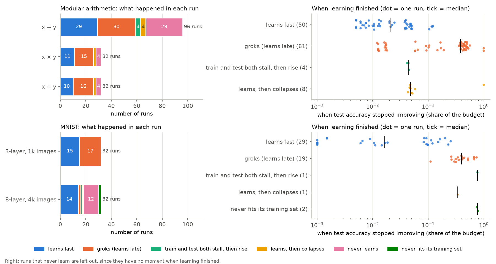

**Figure 1.** Left: outcome counts per task variant. Right: when test accuracy stopped
improving, as a share of the budget (log scale).

### Modular arithmetic (160 runs)

| Outcome | x + y | x × y | x ÷ y | Total | When learning finished (median share of budget) | Best test accuracy (median) |
|---|---|---|---|---|---|---|
| learns fast | 29 | 11 | 10 | **50** | 2% | 100% |
| groks | 30 | 15 | 16 | **61** | 38% (spread from 1% to the very end) | 100% |
| train and test stall, then rise | 4 | 0 | 0 | 4 | 4% | 100% |
| learns, then collapses | 4 | 2 | 2 | 8 | 5% | 100% |
| never learns | 29 | 4 | 4 | **37** | — | 1% (chance) |

- **Never learns.** 32 of these 37 runs have no weight decay. They memorize the training
  pairs and never generalize within the budget.
- **When learning finishes.** Most runs that learn are done early: half of all learners
  finish within the first 5% of the budget.
- **Grokking runs are spread out:**
  - 15 grok within the first 2% of the budget;
  - 12 between 2% and 35%;
  - 31 at 35–55%;
  - 3 later still.
  Test accuracy jumps from chance to 100% in a short stretch (Figure 2).

### MNIST (64 runs)

| Outcome | 3-layer | 8-layer | Total | When learning finished (median share of budget) | Best test accuracy (median) |
|---|---|---|---|---|---|
| learns fast | 15 | 14 | **29** | 1.6% | 93% |
| groks | 17 | 2 | **19** | 40% | 91% |
| train and test stall, then rise | 0 | 1 | 1 | 77% | 62% |
| learns, then collapses | 0 | 1 | 1 | 34% | 55% |
| never fits its training set | 0 | 2 | 2 | 76% | 81% |
| never learns | 0 | 12 | **12** | — | 37% |

- **Network depth.** The 3-layer runs all learn, either fast or by grokking. The 8-layer
  network is much harder to train: 12 of its 32 runs never pass 50% test accuracy. Eight
  of them are SGD runs at learning rate 10⁻⁴, which barely move in 100,000 steps.
- **What "grokking" means on MNIST.** It is gentler than on modular arithmetic. Test
  accuracy creeps up over a long stretch rather than jumping from chance to perfect.
  This matters for how costly an early stop is (section 9.3).

## 6. The score, and the settings we varied

Every stop gets a **score**; lower is better.

> **score = accuracy lost + λ × budget wasted**
>
> - **accuracy lost** = best test accuracy of the run − test accuracy at the stop
> - **budget wasted** = (stop step − t_ε) / budget, or 0 if the stop is before t_ε
> - a rule that never fires is scored as stopping at the end of the budget

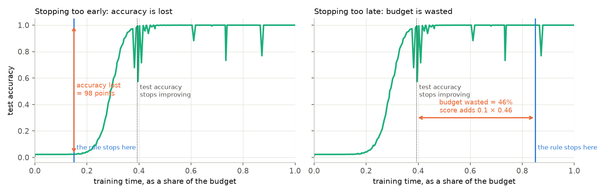

**Figure 2.** One modular grokking run. Stopping before the jump loses almost all the
accuracy (left). Stopping long after it wastes budget (right).

**Settings we varied.**

- **λ, the price of compute: 0.03, 0.1 (main) or 0.3.**
  - At λ = 0.1, wasting the entire budget costs as much as losing 10 accuracy points.
  - 0.03 means accuracy matters most; 0.3 means compute matters most.
  - Every rule is re-tuned separately for each λ.
- **Two held-out tests** (section 8).

**Fixed throughout.**

- **ε = 1 point.** Test accuracy counts as finished once it is within 1 point of its
  best.
- **Other measures reported alongside the score:**
  - accuracy lost;
  - budget wasted;
  - **stopped too early**: the share of runs stopped before t_ε;
  - the share of runs where the rule **never stopped**.

**Reading the numbers.**

- Training every run to the end scores 0.10–0.14 at λ = 0.1.
- Stopping exactly at t_ε scores below 0.01.
- Even "never stop" loses a few accuracy points on average. Test accuracy sometimes
  peaks and then sags late in training, so the final model is not the best one seen.

## 7. The candidate stopping rules

| Candidate | Uses the test set? | Uses the future? | Settings tuned over | Role |
|---|---|---|---|---|
| **Never stop** | no | no | — | the default to beat |
| **Fixed fraction** | no | no | stop at 2, 5, 10, 15, 20, 30, 40, 50, 70 or 100% of the budget | the simplest competitor; F2 must beat it to be worth using |
| **F2-A** extrapolated rotation | no | no | 324 | section 3 |
| **F2-B** rotation, growing window | no | no | 270 | section 3 |
| **F2-C** rotation, fixed window | no | no | 300 | section 3 |
| **F2-D** drift test | no | no | 24 | section 3 |
| **F2-E** early-vs-late test | no | no | 36 | section 3 |
| **F2, tuned pick of A–E** | no | no | all 954 F2 settings | the honest single answer to "how good is F2?": the best F2 setting on the tuning runs, whichever variant it belongs to, scored on held-out runs |
| **Oracle: alignment with final** | no | **yes** | stop at the first point where alignment with the final features ≥ 0.9, 0.95, 0.98, 0.99, 0.995 or 0.999; for M, G or W | Mallinar's own measure as a stopping rule; roughly the best any "features have settled" rule could do |
| **Oracle: stays near final** | no | **yes** | stop once the angle to the final features stays below 0.03–0.5 rad for the rest of training; for M, G or W | a second version of the same ceiling |
| **Perfect stop** | **yes** | yes | — | stops exactly at t_ε; the floor no fair rule can reach |

**Which F2 to look at.** The previous version of this report highlighted F2-C. That was
chosen after seeing results. Here all five variants are shown on equal terms, and the
**tuned pick** is the version chosen by a procedure fixed in advance.

## 8. How the rules were tuned and tested

Every candidate has settings to choose. Choosing them on the same runs used for scoring
would flatter every rule. So for each candidate we:

1. computed the average score of every one of its settings on a set of **tuning runs**;
2. kept the setting with the lowest average;
3. scored that one setting on **held-out runs** it had never seen.

The held-out score is the number reported. We did this twice, for two kinds of novelty:

| Test | Tuning runs | Held-out runs | What it asks |
|---|---|---|---|
| **Test A: new seeds** | seeds 0–1 of every setting (modular 80 runs, MNIST 32) | seeds 2–3 of the same settings (modular 80, MNIST 32) | Does the rule work on new runs of familiar settings? |
| **Test B, modular: new operations** | all x + y runs (96) | all x × y and x ÷ y runs (64) | Does it work on a task it was not tuned on? |
| **Test B, MNIST: a deeper network** | 3-layer runs (32) | 8-layer runs on 4× more data (32) | Does it work on a different architecture? |

**Uncertainty.** Every interval in this report is a 95% *cluster bootstrap* interval,
computed on the held-out runs only.

1. **The unit is a setting, not a run.** The held-out runs are grouped by
   hyperparameter setting. Each setting contributes 2 runs in Test A (seeds 2–3) and 4
   runs in Test B. The groups are:

   | | Modular | MNIST |
   |---|---|---|
   | Test A | 40 settings | 16 settings |
   | Test B | 16 settings | 8 settings |

   Seeds of one setting behave alike, so treating them as independent would overstate
   the precision. The settings are the independent units.
2. **Resample settings.** Draw as many settings as there are, at random *with
   replacement*. Some settings appear twice, some not at all. Take all the runs of the
   drawn settings and average their scores.
3. **Repeat and read off the interval.** Do this 2,000 times. The 2.5th and 97.5th
   percentiles of the 2,000 averages are the interval (a percentile bootstrap, with a
   fixed random seed so it reproduces).
4. **Comparisons between two rules are paired.** For "rule X minus the fixed fraction",
   first compute the difference on each held-out run, since both rules are scored on the
   same runs. Then bootstrap that per-run difference exactly as above. Pairing removes
   the variation that both rules share: some runs are hard for every rule. This is why
   two rules can have overlapping score intervals and still be clearly different.
5. **Verdicts come from the paired interval.**
   - **Clearly better:** the interval lies entirely below 0.
   - **Clearly worse:** the interval lies entirely above 0.
   - **Tie:** the interval includes 0. The data cannot tell the two rules apart.

**What the interval does and does not include.**

- **Included:** the luck of *which settings* ended up in the held-out set.
- **Not included:** the luck in *tuning*. The tuned setting is held fixed; a different
  tuning set might have picked a different setting (Figure 12 shows how much that
  matters).
- **Coarse with few settings.** With only 8 settings (MNIST, Test B), the intervals are
  rough, and a verdict near the edge should be read as "borderline". An example is the
  MNIST Test A tuned pick, whose interval against the fixed fraction starts at +0.0001.

**Expect the tuning score to look better than the held-out score.** Picking the best of
hundreds of settings on the tuning runs partly picks luck, and that luck does not carry
over. Figure 12 shows how large the drop is.

## 9. Results

All results are at λ = 0.1 unless stated otherwise.

### 9.1 Overview

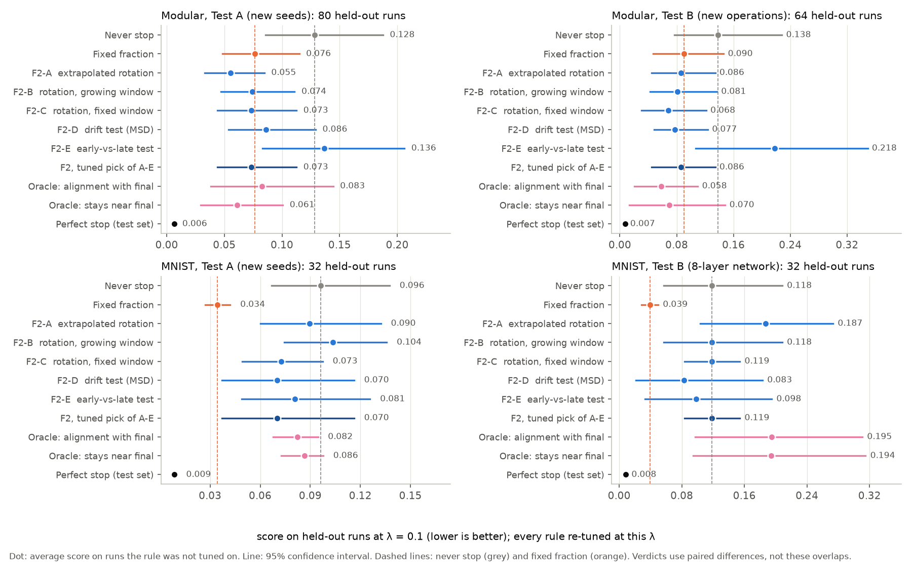

**Figure 3.** Held-out score of every candidate at λ = 0.1. Dot: average; line: 95%
interval. The dashed lines mark never stop (grey) and the fixed fraction (orange).

**Overlapping intervals are not the test.** Whether one rule is better than another is
decided by the paired interval of their difference (section 8), and that is what the
last two columns of the table below report. Paired intervals are much narrower than the
overlap of two score bars suggests. The same figure at the other two values of λ is in
section 9.8 (Figures 4a and 4b).

The headline numbers (all candidates, all tests and all three λ are in
[tables/summary.csv](tables/summary.csv)):

| | Candidate (tuned setting) | Score | Accuracy lost (points) | Budget wasted | Stopped too early | Never stopped | vs never stop | vs fixed fraction |
|---|---|---|---|---|---|---|---|---|
| **Modular A** | Never stop | 0.128 | 4.5 | 84% | 0% | 100% | — | worse |
| | Fixed fraction (stop at 50%) | 0.076 | 3.9 | 38% | 7.5% | 0% | better | — |
| | F2-A | 0.055 | 2.7 | 28% | 3.8% | 25% | better | tie |
| | F2-B | 0.074 | 2.4 | 50% | 0% | 50% | better | tie |
| | F2-C (= tuned pick) | 0.073 | 3.6 | 37% | 1.3% | 13% | better | tie |
| | F2-D | 0.086 | 3.1 | 55% | 0% | 58% | tie | tie |
| | F2-E | 0.136 | 5.5 | 81% | 0% | 95% | tie | worse |
| | Oracle: alignment | 0.083 | 4.8 | 34% | 5% | 0% | better | tie |
| **Modular B** | Never stop | 0.138 | 5.6 | 82% | 0% | 100% | — | tie |
| | Fixed fraction (stop at 40%) | 0.090 | 6.6 | 25% | **25%** | 0% | tie | — |
| | F2-A (= tuned pick) | 0.086 | 4.8 | 38% | 4.7% | 25% | tie | tie |
| | F2-B | 0.081 | 3.2 | 49% | 0% | 48% | better | tie |
| | F2-C | 0.068 | 3.2 | 36% | 0% | 9% | better | tie |
| | F2-D | 0.077 | 2.2 | 56% | 0% | 64% | better | tie |
| | F2-E | 0.218 | 16.9 | 50% | 14% | 56% | tie | tie |
| | Oracle: alignment | 0.058 | 2.9 | 29% | 0% | 0% | better | tie |
| **MNIST A** | Never stop | 0.096 | 2.4 | 72% | 0% | 100% | — | worse |
| | Fixed fraction (stop at 30%) | **0.034** | 2.0 | 14% | 41% | 0% | better | — |
| | F2-A | 0.090 | 2.4 | 65% | 0% | 84% | tie | worse |
| | F2-B | 0.104 | 3.6 | 67% | 9% | 91% | tie | worse |
| | F2-C | 0.073 | 4.2 | 31% | 38% | 13% | tie | worse |
| | F2-D (= tuned pick) | 0.070 | 2.6 | 45% | 19% | 69% | better | worse |
| | F2-E | 0.081 | 2.4 | 57% | 3% | 84% | tie | worse |
| | Oracle: alignment | 0.082 | 1.8 | 64% | 13% | 0% | tie | worse |
| **MNIST B** | Never stop | 0.118 | 4.8 | 70% | 0% | 100% | — | worse |
| | Fixed fraction (stop at 40%) | **0.039** | 1.8 | 22% | 25% | 0% | better | — |
| | F2-A | 0.187 | 12.2 | 65% | 25% | 75% | tie | worse |
| | F2-B | 0.118 | 4.8 | 70% | 0% | 100% | tie | worse |
| | F2-C (= tuned pick) | 0.119 | 7.0 | 49% | 38% | 50% | tie | worse |
| | F2-D | 0.083 | 5.8 | 25% | 38% | 50% | better | tie |
| | F2-E | 0.098 | 5.0 | 48% | 9% | 78% | tie | tie |
| | Oracle: alignment | 0.195 | 14.0 | 55% | 25% | 0% | tie | worse |

Perfect stop scores 0.006–0.009 everywhere.

The observations below each come with a reason. Four facts about the data explain
everything that follows, and are referred to by letter:

- **(F1) On modular arithmetic, the features and test accuracy change together.** The
  features swing into their final form during the jump in test accuracy and finish
  settling soon after (Figures 7 and 8).
- **(F2) On MNIST, test accuracy finishes long before the features do.** The features
  keep rotating until the end of the budget, whenever that is (Figures 7 and 8).
- **(F3) Most runs finish learning early in the budget.** The medians are 2% for fast
  learners and about 40% for grokkers, on both tasks (Figure 1). A rule that stops
  anywhere in the middle therefore saves a lot of budget, and that is what a fixed
  fraction does.
- **(F4) Stopping a grokking run too early is very costly on modular arithmetic and cheap
  on MNIST.** On modular the jump is from chance to 100%, about 98 points. On MNIST the
  last stretch before t_ε adds only a few points.

### 9.2 Modular: F2 clearly beats training to the end, but only ties the fixed fraction

**Observation.**

- **Against training to the end.**
  - F2-B and F2-C beat "never stop" on both tests. F2-C cuts the score by 43% on new
    seeds and 51% on new operations, and is better in all 16 settings of Test B.
  - F2-A beats it on new seeds, F2-D on new operations.
  - F2-E never does.
- **Against the fixed fraction.** No variant is clearly better than the tuned fixed
  fraction, on either test (table above, last column). The averages of F2-A to F2-C (and F2-D on new
  operations) favour F2, by 0.002 to 0.022, but every interval includes 0.

**Why F2 beats never stopping.** By (F1), "the features have stopped moving" happens
shortly after test accuracy stops improving. By (F3), that is usually early in the
budget, so F2 saves most of the wasted budget (37% wasted instead of 84% for F2-C)
without losing accuracy.

**Why it only ties the fixed fraction.** The two rules win on different runs, and the
gains roughly cancel. On held-out seeds, F2-C against the fixed fraction:

| Runs | F2-C score | Fixed fraction score | Why |
|---|---|---|---|
| fast learners (25) | 0.066 | 0.051 | F2 waits for the features to settle completely. After test accuracy finishes, the last few percent of alignment take another ~10× that time (Figure 8, left). For a run that finishes at 1% of the budget, that slow final drift can last a good part of the budget. F2 stopped these runs anywhere from 13% to 94% of the budget; the fixed fraction stops at 50% regardless. |
| grokkers (30) | 0.038 | 0.042 | F2 stops when *this* run has settled. The fixed fraction stops some grokkers before their jump. |

The intervals are also wide (about ±0.03–0.04) because there are only 16–40 independent
settings per test. A real but small edge would not show up as "clearly better".

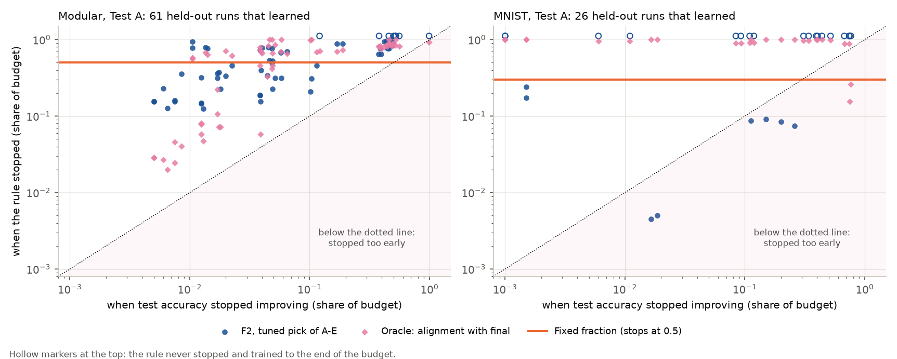

**Figure 5.** Where each rule stops on the held-out runs of Test A that learned. Each dot
is one run. The dotted diagonal is a perfect stop; below it the rule stopped too early;
hollow markers at the top never stopped. The fixed fraction is a flat line: it stops
every run at the same time.

On modular (left), the F2 stops rise with t_ε, staying above the diagonal: F2 adapts to
each run. The fixed fraction stops the many early learners far too late and the latest
grokkers too early.

### 9.3 Modular: F2 does not cut off slow learners

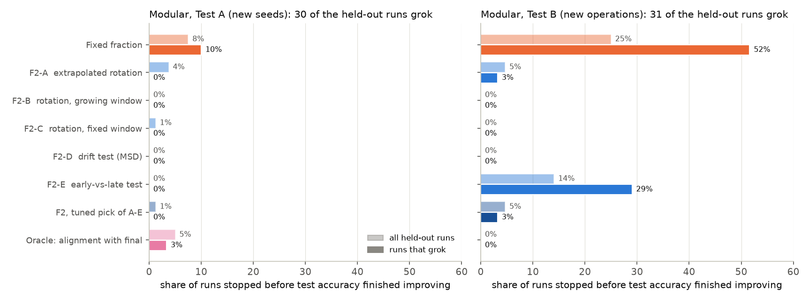

**Figure 6.** Share of held-out modular runs stopped before test accuracy had finished
improving. Light bars: all runs; dark bars: grokking runs.

**Observation.**

- **The fixed fraction.** Tuned on x + y to stop at 40%, it stops **52% of the grokking
  runs** of x × y and x ÷ y before they generalize. On new seeds it cuts off 10%.
- **F2-B, F2-C and F2-D** cut off no grokking run on either test. For F2-B and F2-D
  this is partly because they seldom stop grokking runs at all (section 9.7). F2-C does
  stop them, after the jump.
- **F2-A** cuts off 1 of 31.
- **F2-E** is the exception: its tuned threshold fires before test accuracy has
  finished improving on 9 of 31 grokking runs of Test B.

**Why.**

- **The fixed fraction.** It cannot know when a particular run will grok. The new
  operations grok later than x + y did (Figure 1: many at 40–55% of the budget), so a
  fraction that suited x + y comes too early for them.
- **F2.** By (F1), the features are visibly moving during the jump, so a rule that waits
  for them to stop also waits for the jump.
- **Why it doesn't show in the average.** By (F4) each such cut costs about 98 points,
  but by (F3) only a minority of runs are late grokkers. The fixed fraction's savings on
  everything else roughly pay for them. That is why Test B's averages tie even though the
  fixed fraction is much less safe.
- **Training to the end is no clear winner either.** On Test B the fixed fraction is not
  clearly better than never stopping (table above, Modular B). F2-B, F2-C and F2-D are.

### 9.4 Why: features and accuracy, run by run

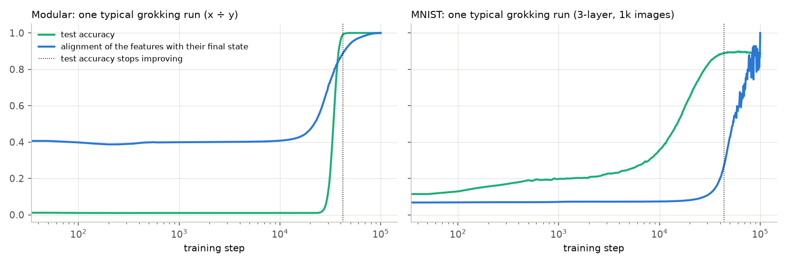

**Figure 7.** One typical grokking run from each task. Green: test accuracy. Blue:
alignment of the features with their final state (1 = identical). Dotted: t_ε. The step
axis is logarithmic.

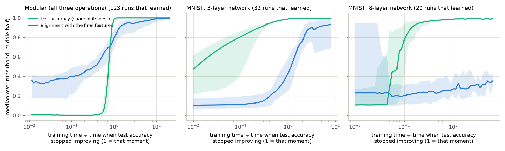

**Figure 8.** The same two curves as medians over all runs that learned, with each run's
time axis divided by its t_ε (so 1 = the moment test accuracy stopped improving). Bands
hold the middle half of runs. MNIST is split by network.

| | Modular (123 runs) | MNIST 3-layer (32) | MNIST 8-layer (20) |
|---|---|---|---|
| Alignment with the final features when test accuracy stops improving (median) | **0.80** | **0.44** | **0.27** |
| Weight norm at the end ÷ weight norm at t_ε | 0.88 | 0.53 | 0.78 |
| Effective rank of the AGOP at the end ÷ at t_ε | 1.03 | 0.27 | 0.26 |

This table is the evidence for (F1) and (F2).

- **Modular.** When test accuracy stops improving, the features are already 0.80 aligned
  with their final form. They finish settling within a few multiples of that time, and
  nothing much changes afterwards: the weights shrink only slightly and the AGOP's rank
  stays the same.
- **MNIST.** Test accuracy is finished while the features are still far from final:
  0.44 and 0.27 aligned.
  - **After that the network keeps changing a lot.** The 3-layer network's weights
    shrink by about half, and the AGOP concentrates on about a quarter as many
    directions.
  - **Test accuracy does not notice.** The network keeps simplifying its features under
    weight decay, which neither helps nor hurts the test score.
  - **What "the features have settled" means here.** It arrives only near the end of the
    budget, so it marks "training is about to end", not "learning has ended".

### 9.5 MNIST: F2 loses to the fixed fraction

**Observation.**

- **Against the fixed fraction.**
  - On new seeds, every F2 variant is clearly worse than the fixed fraction, including
    the tuned pick (F2-D: 0.070 against 0.034).
  - On the deeper network, F2-A, F2-B, F2-C and the tuned pick are clearly worse; F2-D
    and F2-E tie.
- **Against training to the end.** Only F2-D beats it, on both tests.

**Why.**

- **Late or never.** By (F2), the features of most MNIST runs are still moving at the
  end of the budget. So F2 variants often never fire (F2-A, B and E never stop on
  75–100% of runs) and waste 25–70% of the budget, against 14–22% for the fixed
  fraction.
- **Stops unrelated to accuracy.** When they do fire, the timing has nothing to do with
  accuracy. Figure 5 (right) shows the tuned pick stopping some runs well before their
  t_ε, at a quarter of it or less, and never stopping others.
- **Why the fixed fraction wins here.** By (F3), stopping at 30–40% of the budget saves
  most of the waste. By (F4), its early stops are cheap on MNIST. On held-out seeds it
  stops 70% of the grokking runs before t_ε, yet loses only 2.6 points on them on
  average.
- **Why F2-D does a little better than the rest.** It is the only variant that clearly
  beats never stopping. It stops some runs in the middle of the budget, which by (F3)
  helps whatever the reason for stopping.

### 9.6 Is the problem the online estimate, or the idea itself?

To separate the two, we gave the idea every advantage: the **oracles know the true final
features**.

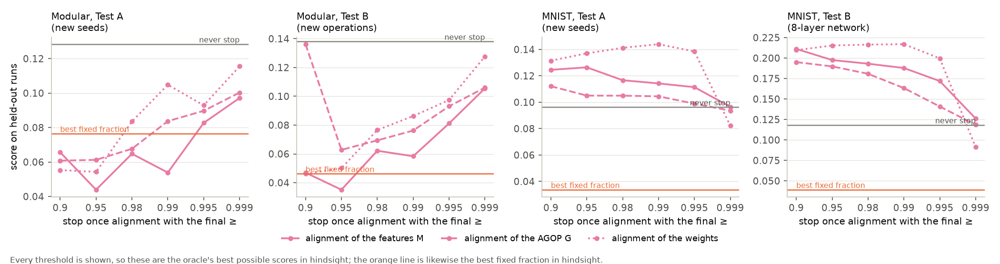

**Figure 9.** Held-out score of the alignment oracle at **every** threshold, for M, G and
W, against never stopping (grey) and the best fixed fraction (orange). Showing every
threshold makes these the oracle's best scores in hindsight. The orange line is likewise
the best fraction in hindsight.

**MNIST: the idea itself fails.**

- Even the best oracle threshold in hindsight scores 0.082 (seeds) and 0.091 (deeper
  network). The best fixed fraction scores 0.034 and 0.039.
- With its threshold tuned honestly, the oracle is no better than never stopping, and on
  the deeper network it is worse (0.195 against 0.118). The threshold tuned on the
  3-layer network (alignment ≥ 0.9) fires very early on the 8-layer runs that barely
  learn. Their features hardly move, so they look "final" early, while their accuracy
  still creeps up.
- By (F2), knowing exactly where the features will end up does not tell you when
  accuracy stopped improving. **No online version of F2 can work on MNIST**, however
  good its estimate.

**Modular: the information is there, but hard to exploit.**

- The best oracle threshold in hindsight does beat the best fixed fraction: 0.044
  against 0.076 on new seeds, 0.035 against 0.046 on new operations.
- But the oracle's score swings with its threshold (Figure 9: from 0.044 to about 0.11). The
  threshold tuned on other runs lands on 0.083 and 0.058, which ties the fixed fraction.
- So on modular, the features carry real information about when learning ends, beyond
  "a good fraction of the budget has passed". With 80 tuning runs, though, the threshold
  cannot be set precisely enough to turn that into a clear win. At λ = 0.3 it can: there
  both tuned oracles clearly beat the fixed fraction on new seeds (section 9.8).

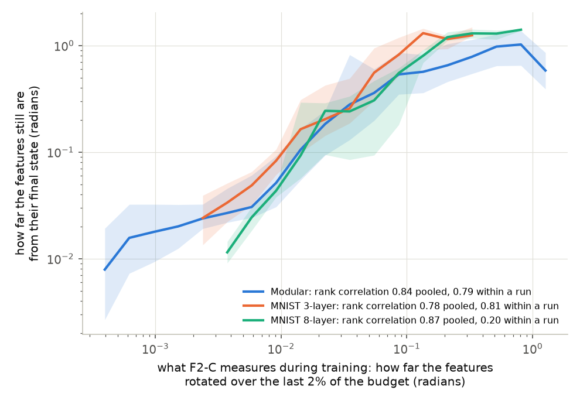

**Figure 10.** F2-C's online measurement (how far the features rotated over the last 2%
of the budget, horizontal axis) against how far they truly still are from their final
state (vertical axis, known only afterwards). Lines are medians; bands hold the middle
half.

**How faithful is the online measurement?** We measured this as the rank correlation
between F2-C's angle and the true remaining angle.

| | Modular | MNIST 3-layer | MNIST 8-layer |
|---|---|---|---|
| Within a run (median over runs) | **0.79** | **0.81** | 0.20 |
| Pooled over all points of all runs | 0.84 | 0.78 | 0.87 |
| Same for F2-A's extrapolated bound, within a run | 0.37 | −0.01 | −0.17 |

- **F2-C tracks the truth well** on modular and on the 3-layer MNIST network.
- **On the 8-layer network it is weak within a run.** It separates runs that are far
  from done from runs that are nearly done, but it orders the steps of a single run
  poorly. This does not change the MNIST verdict, because the oracle above, which has
  perfect knowledge, fails as well.
- **F2-A's extrapolation tracks the truth poorly everywhere.** The slow-down rate it
  extrapolates from is noisy, and it changes abruptly after the training set is fit.
  This is the failure that motivated variants B–E (section 2, step 6b). F2-A still
  scores well on modular new seeds, because its *tuned threshold* happens to work there.
  It does not transfer to new operations or to MNIST.

### 9.7 What a good modular score is made of

Two rules with the same score can get there differently, so the score's parts matter
(the headline table in 9.1).

- **F2 variants lose less accuracy than the fixed fraction.** On modular new operations,
  F2-B, F2-C and F2-D lose 2.2–3.2 points, against 6.6 for the fixed fraction.
- **They pay for that by training longer.** They waste 36–56% of the budget, against 25%.
- **A large part of F2's waste is runs where it never stops** (9–64% of runs), and these
  are mostly **grokking runs**.
  - F2-B never stops on 24 of the 31 grokking runs of Test B, and F2-D on 23.
  - After the jump, these runs' features settle to within a few percent of their final
    form but keep a slow drift until the end of the budget (Figure 8, left). The strict
    thresholds that tuning chose for F2-B and F2-D never see that drift fall far enough.
  - Never stopping a run that has already generalized costs budget, not accuracy.
- **This qualifies the safety result in 9.3.**
  - F2-B and F2-D cut off no grokker partly because they rarely stop grokkers at all.
  - F2-C is the variant that does both: it stops all but 3 of the 31 grokking runs, and
    every one of those stops comes after the run has generalized.

### 9.8 Does the verdict depend on how much compute costs?

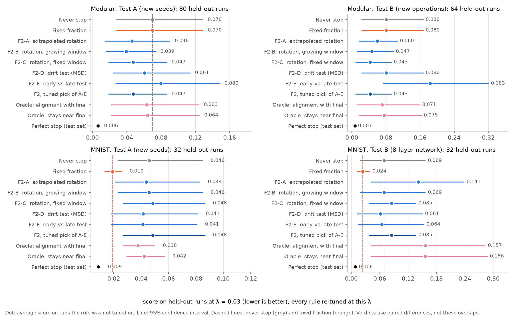

**Figure 4a.** As Figure 3, with every rule re-tuned for λ = 0.03 (accuracy first).

- **Modular.** The fixed fraction's bar sits on top of never stopping: its best fraction
  is now 100%. Several F2 variants score below both. The best are:
  - new seeds: F2-B at 0.039 against 0.070;
  - new operations: F2-C at 0.043 against 0.080.

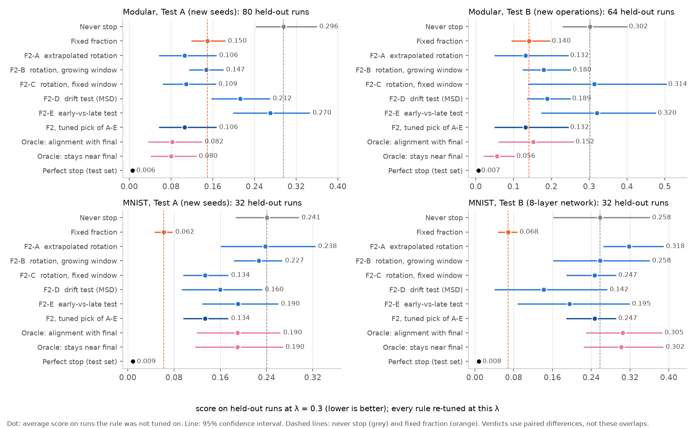

**Figure 4b.** As Figure 3, at λ = 0.3 (compute first).

- **Scale.** Every score grows, because waste is now three times as expensive.
- **Modular.** F2-A and F2-C beat never stopping by a wide margin on new seeds, and the
  oracles drop to 0.08. On new operations, F2-C's interval stretches up to 0.5: on some
  settings it stops before the jump.
- **MNIST.** The fixed fraction (0.062, 0.068) is far below every other candidate.

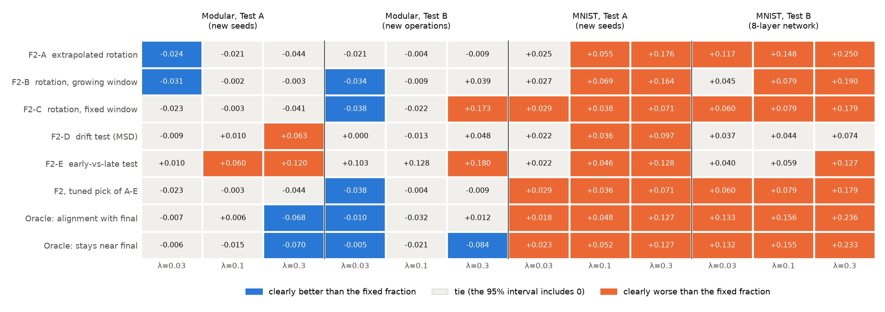

**Figure 11.** The verdicts behind Figures 3, 4a and 4b in one grid. Each cell is the
paired difference, score minus the fixed fraction's score on the same runs, with its
colour set by the paired 95% interval (section 8):

- **Blue:** clearly better than the fixed fraction.
- **Orange:** clearly worse.
- **Grey:** tie.

Every rule was re-tuned at each λ.

**Accuracy first (λ = 0.03).**

- **Observation.** The tuned fixed fraction on modular becomes "stop at 100%", which is
  never stopping. Several F2 variants then beat it:
  - F2-A and F2-B on new seeds;
  - F2-B and F2-C (the tuned pick) on new operations.
- **Why.** When accuracy is expensive, any cut that might hit a grokker costs more than
  it saves, so the best fixed fraction is no cut at all. F2 still stops each run after
  its own features have settled, which by (F1) is safe. So it saves budget for free.

**Compute first (λ = 0.3).**

- **Observation, modular.**
  - On new seeds, F2-A, F2-B, F2-C and the tuned pick still tie the fixed fraction; F2-D
    and F2-E are worse. Both oracles become clearly better than the fixed fraction.
  - On new operations, F2-C tuned on x + y becomes clearly worse than the fixed
    fraction: it stops 23% of runs too early, including 48% of the grokking runs. The
    tuned pick (F2-A) ties.
- **Why.** When compute is expensive, tuning pushes every rule's threshold towards
  stopping sooner.
  - F2-C's tuned threshold (0.1 rad over 5% of the budget, on M) is loose enough to fire
    before the jump on x × y and x ÷ y.
  - **F2's safety (9.3) is therefore a property of a cautious threshold, not a
    guarantee.** A threshold tuned for cheap compute gives it up.
  - The oracles become clearly better because the extra timing information in the
    features (9.6) now outweighs the noise in tuning.
- **MNIST.** At every λ, every F2 variant is worse than the fixed fraction or tied with
  it, by (F2) and (F3).

### 9.9 Does the tuning carry over?

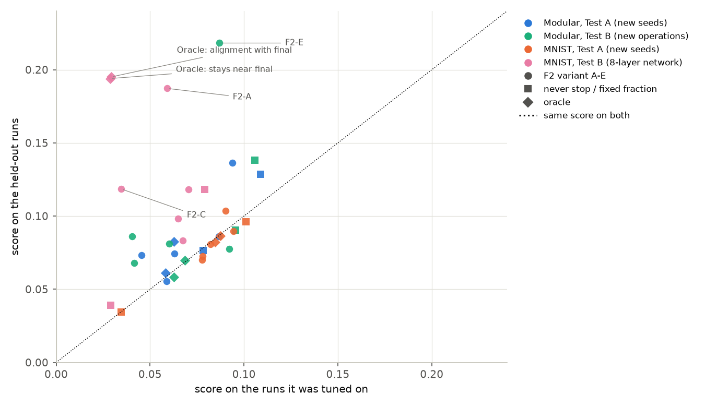

**Figure 12.** Each tuned candidate's score on its tuning runs against its held-out
score. Points above the diagonal did worse on new runs than on the runs they were tuned
on.

**Observation.**

- **On new seeds (blue and orange points),** most candidates land close to the diagonal,
  slightly above it: the expected optimism of picking the best of many settings.
- **Never stop and the fixed fraction** carry over almost exactly.
- **The largest misses are threshold rules moved to a new setting:**
  - on the deeper MNIST network, both oracles, F2-A and F2-C;
  - on the new modular operations, F2-E.

**Why.**

- **A budget fraction means the same thing on any task with the same budget.**
- **An angle threshold depends on how fast a particular network's features move.** That
  changes with depth, width and data. A threshold that marks "settled" for a 3-layer
  network marks something else for an 8-layer one.

## 10. Conclusion

1. **On grokking tasks such as modular arithmetic, F2 is a real, test-free stopping
   signal.**
   - Tuned on one set of runs and applied to new seeds or new operations, the simple
     rotation rules (F2-B, F2-C) cut the cost of training to the end by 41–51%.
   - They lose no more accuracy than the alternatives.
   - They did not stop a single grokking run before it generalized, because on this task
     the features move during the jump and settle with it. F2-C stops nearly every
     grokking run after its jump; F2-B often never stops them.
2. **On average, F2 does not beat stopping at a tuned fraction of the budget.**
   - At our main weighting they tie on both tests.
   - F2 wins when accuracy matters most.
   - It can lose when compute matters most and the task changes, because its threshold
     is then tuned to be aggressive.
3. **F2's practical advantages are safety and needing less prior knowledge.**
   - It does not cut off late learners; the fixed fraction cut off half of them on new
     operations.
   - F2-B needs no knowledge of a sensible budget at all.
4. **The features do contain more timing information than a budget fraction.** The
   oracle shows this on modular. The online variants could not turn it into a clear win
   with the tuning data we had.
5. **On MNIST, F2 does not work, and no feature-settling rule can.** Test accuracy
   finishes while the features are far from final. Afterwards the features keep
   simplifying until the end of training. Even perfect knowledge of the final features
   does no better than training to the end, and every variant is beaten by a fixed
   fraction.
6. **Keep the simplest version.**
   - Among online variants, the plain rotation measured over a window (F2-B, F2-C)
     tracks the true remaining change best and transfers best between tasks.
   - Extrapolating the slow-down (F2-A) and the statistical settling tests (F2-D, F2-E)
     add noise rather than accuracy.

---

## Appendix: files and reproduction

| Path | Contents |
|---|---|
| `figures/*.png` | the thirteen figures above (03, 04a and 04b are the scores at λ = 0.1, 0.03 and 0.3) |
| `tables/summary.csv` | every candidate × test × λ: tuned setting, tuning and held-out score with interval, accuracy lost, budget wasted, stopped too early, never stopped, grokkers stopped too early, differences against never stopping and the fixed fraction with intervals and verdicts |
| `tables/by_outcome.csv` | held-out score split by run outcome (fast, groks, …) for the main candidates |
| `tables/corpus.csv` | the 224 runs by task variant: hyperparameter values and outcome counts |
| `tables/numbers.txt` | every number quoted in this report, as printed by `make_figures.py` |
| `make_figures.py` | `python report_AGOP/make_figures.py <folder with rows.parquet and series.parquet>` regenerates all of the above |
| `detailed/` | the earlier technical report, its figures and tables (`calibration.csv` has every candidate × test × λ, including sign tests and hindsight settings), and the per-run diagnostics |
| HF `advay333/tfs`, folder `phase4/agop_final/` | `rows.parquet` (score of every setting of every rule on every run), `series.parquet` (per-step curves), and the raw feature traces |
| `stopping/agop_final.py`, `stopping/agop_study.py` | the code that computes every variant, oracle and score |
