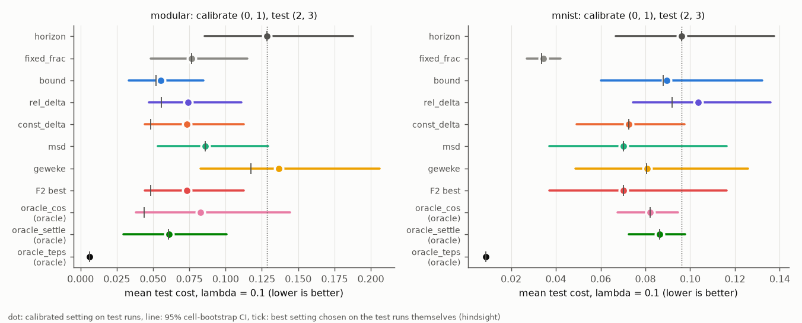
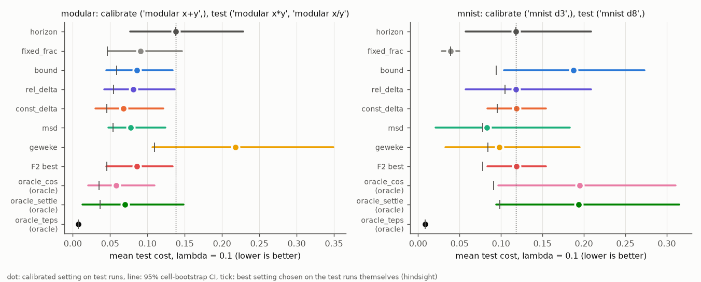
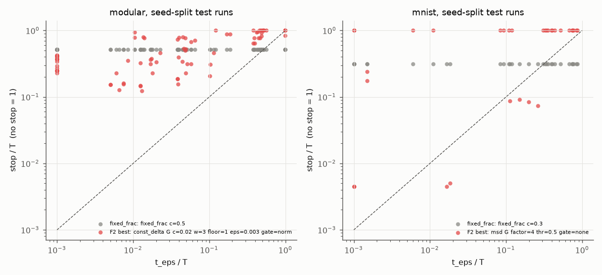
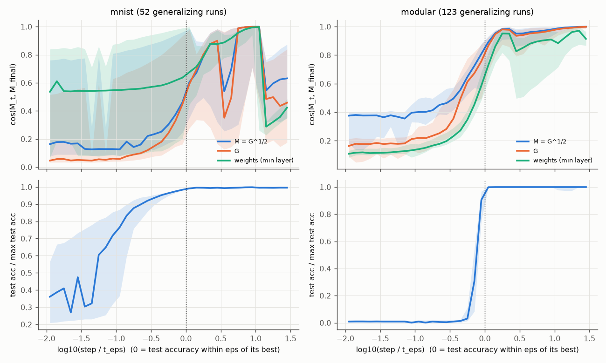

# F2 (online AGOP settling) as a stopping rule: final report

Status (2026-11-15): **done.** 224 runs, all replayed with verification and all analyzed,
with no failures. The run took 132 minutes on the Molab RTX Pro 6000, with 14 replay
workers and 20 analysis workers.

Where things are:

- **Figures:** `figures/`.
- **Tables:** `tables/`. `calibration.csv` holds every family, split and λ.
- **Machine summary:** `REPORT_auto.md`.
- **Per-run diagnostics and run status:** `data/`.
- **Full outputs on HF:** `advay333/tfs:phase4/agop_final/`. This includes `rows.parquet`
  (every rule setting × run), `series.parquet` (per-step curves) and the traces.

## 0. Verdict

| Claim | Result |
|---|---|
| F2 beats training to the horizon on modular | **Yes, conclusively.** It holds on both held-out splits: the cost drops by 38–57%, the CI excludes 0, and it wins in 33 of 36 and 16 of 16 cells. |
| F2 beats a calibrated fixed fraction of the budget on modular | **No, not shown.** F2 is 4–28% cheaper, but every CI includes 0. Even the oracles that know the final AGOP don't clear this bar. |
| F2 is safer than a fixed fraction on modular | **Yes.** It stops before t_ε in 0–5% of runs, against 7.5–25% for the fixed fraction. It never stops before t_ε on a grokker; the fixed fraction does so in 12.5% of grokkers. |
| F2 does not work on MNIST | **Yes, conclusively.** The calibrated fixed fraction beats every online F2 family, with the CI excluding 0. The final-AGOP oracles are no better than the horizon. |
| The online AGOP tracks the true remaining angle to the final AGOP | **The constant-delta angle does**: Spearman 0.79 on modular, 0.76 on MNIST. The κ-bound R does so poorly: 0.37 and −0.07. |

In one line: on modular, AGOP settling is a real and safe stopping signal, but it is only
as good as "stop at the right fraction of the budget". On MNIST the features keep turning
long after test accuracy has settled, so their settling carries no information about when
to stop. The failure is not in the estimate: even knowing the final AGOP does not help.

## 1. The question

F2 asks whether the network's features have stopped moving. The features are
M = G^{1/2}, where G is the input AGOP on the training set, normalized to unit
Frobenius norm. Mallinar et al. show that M ends up aligned with its final value as the
network generalizes. F2 turns that into a test-free stopping rule: stop once M has
settled. The earlier experiment (results/phase4/RESULTS.md) found:

- **MNIST:** the features keep turning long after test accuracy has settled.
- **Modular:** a remaining-angle rule halved the cost of training to the horizon.

That modular result was picked as the best of about 400 settings on 17 runs, so it was
optimistic. This study re-tests it on held-out runs.

## 2. Protocol

**Runs.** Whole hyperparameter cells, all 4 seeds each. Cells are picked round-robin
over the seed-0 outcome categories per variant and optimizer:

| | Cells | Runs |
|---|---|---|
| Modular x+y | 6 per optimizer (24) | 96 |
| Modular x*y, x/y | 2 per optimizer each (16) | 64 |
| MNIST d3, d8 | 2 per optimizer each (16) | 64 |
| **Total** | **56** | **224** |

- 188 runs were replayed for this study and 36 traces came from the earlier experiment.
- Every replay was checked against the recorded run: telemetry, predictions (≥ 99.9%
  identical) and weight fingerprints (relative error ≤ 1e-6).
- Each run has 223 eval steps of G, M and the per-layer weights.

**Score.**

- cost_λ = (max test acc − test acc at the stop) + λ·(steps trained after t_ε)/T.
- t_ε is the first step within ε of the best test accuracy.
- A rule that never stops is scored as stopping at T.
- The headline uses λ = 0.1. λ = 0.03 and 0.3 are recalibrated separately.

**Rules.**

| Family | Rule | Causal? |
|---|---|---|
| bound | remaining-angle bound R = θ_lag·q/(1−q) < ε | yes |
| rel_delta | angle over the last lag f·t < ε (the bound without κ) | yes |
| const_delta | angle between M_t and M_{t−Δ}, with Δ = c·T fixed, < ε: **the simplest F2** | yes |
| msd, geweke | settling tests | yes |
| fixed_frac | stop at c·T: **the bar F2 must clear** | yes |
| horizon | never stop | yes |
| oracle_cos | first t with cos(M_t, M_T) ≥ c (Mallinar's alignment) | no |
| oracle_settle | first t after which the angle to M_T stays < δ | no |
| oracle_teps | stop exactly at t_ε | no |

- Each family is searched over the objects M, G and W, with an optional norm gate.
- **"F2 best"** is the online family with the lowest cost on the calibration runs. Like
  the other families, it is chosen on calibration only.

**Calibrate, then test.** For each family, pick the setting with the lowest mean cost on
the calibration runs and score that setting on the test runs.

- **Seed split:** seeds 0–1 → 2–3.
- **Transfer split:** x+y → x*y and x/y; MNIST d3 → d8.
- 95% CIs come from a bootstrap over cells, plus a two-sided sign test over cells.

## 3. Results: modular

`figures/cost_seed_split.png`: each dot is the calibrated rule scored on held-out seeds;
the line is the 95% CI; the tick is the hindsight-best setting.

**Seed split** (80 test runs, 40 cells, λ = 0.1):

| Rule (calibrated setting) | Test cost [95% CI] | Δ vs horizon [CI] | Δ vs fixed [CI] | Premature | Never stops |
|---|---|---|---|---|---|
| horizon | 0.128 [0.086, 0.188] | — | — | 0% | 100% |
| fixed_frac c=0.5 | 0.076 [0.049, 0.115] | −0.052 [−0.107, −0.003] | — | 7.5% | 0% |
| **bound** M, lag 0.15, ε=0.1, norm gate | **0.055** [0.033, 0.085] | **−0.073** [−0.111, −0.046] | −0.021 [−0.060, +0.014] | 3.8% | 25% |
| rel_delta G, lag 0.25, ε=0.01 | 0.074 [0.047, 0.111] | −0.054 [−0.085, −0.029] | −0.002 [−0.050, +0.043] | 0% | 50% |
| **const_delta** G, Δ=0.02T, ε=0.003, norm gate (= F2 best) | 0.073 [0.044, 0.113] | −0.055 [−0.095, −0.028] | −0.003 [−0.034, +0.025] | 1.3% | 13% |
| msd M | 0.086 | −0.042 [−0.087, +0.003] | +0.010 | 0% | 58% |
| geweke G | 0.137 | +0.008 | +0.060 | 0% | 95% |
| oracle_cos M, c=0.995 | 0.083 | −0.046 [−0.069, −0.022] | +0.006 [−0.032, +0.059] | 5% | — |
| oracle_settle M, δ=0.5 | 0.061 | −0.067 [−0.125, −0.016] | −0.015 [−0.042, +0.015] | 20% | — |
| oracle_teps | 0.006 | −0.122 | −0.070 | 0% | — |

**Operation transfer split** (calibrate on x+y, test on x*y and x/y; 64 runs, 16 cells):

| Rule | Test cost | Δ vs horizon [CI] | Δ vs fixed [CI] | Premature |
|---|---|---|---|---|
| horizon | 0.138 | — | — | 0% |
| fixed_frac c=0.4 | 0.091 | −0.048 [−0.113, +0.012] | — | 25% |
| bound W, ε=0.3, norm gate (= F2 best) | 0.086 | −0.052 [−0.109, +0.001], 14 of 15 cells | −0.004 | 4.7% |
| **const_delta** G, Δ=0.1T, ε=0.1 | **0.068** | **−0.070 [−0.107, −0.043], 16 of 16 cells** | −0.023 [−0.065, +0.016] | **0%** |
| rel_delta G | 0.081 | −0.057 [−0.092, −0.029] | −0.009 | 0% |
| oracle_cos M, c=0.99 | 0.058 | −0.080 | −0.032 [−0.073, +0.002] | 0% |

**Reading.**

1. **Every settling family except geweke** cuts the horizon cost on held-out seeds and on
   unseen operations. The constant-delta angle is the most robust: it wins 16 of 16 cells
   on the transfer split and never stops prematurely there.
2. **The calibrated fixed fraction is the real competitor.**
   - F2 is cheaper on average on both splits: by 0.021 (bound, seeds) and 0.023
     (const_delta, transfer).
   - But no CI excludes 0, so this does not meet the criterion set in advance.
3. **The ceiling is low.** Even the oracles that know M_T do not beat the fixed fraction
   with a CI excluding 0 (`figures/oracle_curves.png`, right panel). On these runs, "when
   the AGOP is settled" carries about as much information as "a good fraction of the
   budget". So no online F2 rule could clear that bar clearly.
4. **F2 is a safer rule.** A fixed fraction gets its cost by cutting long runs short:
   - It stops before t_ε in 7.5% (seeds) and 25% (transfer) of runs.
   - On late-collapse runs that rate is 50%, and on grokkers 12.5%.
   - F2 best never stops a grokker early. Its cost on grokkers is 0.037, against 0.048
     for the fixed fraction and 0.068 for the horizon (`tables/categories.csv`).
   - F2 also spends its cost differently: lower regret than the fixed fraction on both splits
     (0.024–0.048 against 0.039–0.066), paid for with somewhat more late training.
5. **Where F2 loses.** F2 best's cost on fast runs is 0.089, against 0.060 for the fixed
   fraction. The AGOP keeps turning slowly after a quick fit, so F2 waits.
6. **Choice of λ** (`tables/calibration.csv`).
   - At λ = 0.03 the calibrated fixed fraction is c = 1, which is the horizon.
   - At that λ, rel_delta and bound beat it on the seed split (CI excludes 0), and
     const_delta beats it on the operation split (−0.038 [−0.074, −0.013]).
   - At λ = 0.3, const_delta calibrated on x+y transfers badly to x*y and x/y: it is
     worse than the fixed fraction by +0.173 [+0.004, +0.361], with 23% premature
     stops. bound ties there, and on the seed split F2 and the fixed fraction tie.

`figures/stops_vs_teps.png` shows where each rule stops. On modular, F2's stop moves with
t_ε, while the fixed fraction is a flat line. The fixed fraction wins on average only
because the stops are so spread out.

## 4. Results: MNIST

**Seed split** (32 runs, 16 cells):

| Rule | Test cost | Δ vs horizon [CI] | Δ vs fixed [CI] |
|---|---|---|---|
| horizon | 0.096 | — | +0.062 [+0.028, +0.108] |
| **fixed_frac c=0.3** | **0.034** [0.027, 0.042] | −0.062 [−0.108, −0.028] | — |
| bound G | 0.090 | −0.007 [−0.018, 0] | **+0.055 [+0.021, +0.100]** |
| rel_delta W | 0.104 | +0.007 | **+0.069 [+0.037, +0.104]** |
| const_delta W | 0.073 | −0.024 [−0.057, +0.011] | **+0.038 [+0.019, +0.062]** |
| msd G (= F2 best) | 0.070 | −0.026 [−0.047, −0.009] | +0.036 [+0.000, +0.086] |
| geweke W | 0.081 | −0.016 | **+0.046 [+0.010, +0.095]** |
| oracle_cos W, c=0.999 | 0.082 | −0.014 [−0.064, +0.018] | **+0.048 [+0.033, +0.061]** |
| oracle_settle W | 0.086 | −0.010 [−0.055, +0.022] | **+0.052 [+0.039, +0.063]** |

**Depth transfer split** (d3 → d8):
- The fixed fraction costs 0.039.
- F2 best (const_delta) costs 0.119, the same as the horizon.
- Both final-AGOP oracles (oracle_cos and oracle_settle) do *worse* than the horizon:
  0.195 and 0.194 against 0.118.

**Reading.** This is the conclusive negative.

- On held-out MNIST runs, every online F2 family is worse than a calibrated fixed
  fraction, and for four of five families the CI clearly excludes 0 (msd's lower end is 0.000).
- None is clearly better than the horizon.
- Knowing the final features does not rescue it. Both oracles are no better than the
  horizon and are significantly worse than the fixed fraction (`figures/oracle_curves.png`,
  left panel: every threshold sits near or above the horizon line).

## 5. How close is the online AGOP to the final AGOP?

`figures/alignment_to_final.png`: the median of cos(M_t, M_T) and of test accuracy,
plotted against step / t_ε across the generalizing runs.

| | Modular (123 runs) | MNIST (52 runs) |
|---|---|---|
| cos(M_t, M_T) at t_ε (median) | **0.81** | **0.36** |
| angle left to M_T at t_ε | 0.64 rad | 1.21 rad |
| change of log‖w‖ after t_ε | −0.10 | −0.57 |
| effective rank of G, final / at t_ε | 1.02 | 0.41 |
| Spearman(bound R, true remaining angle) | 0.37 | −0.07 |
| Spearman(const-delta angle, true remaining angle) | **0.79** | **0.76** |

- **Modular.** The AGOP alignment rises *with* the jump in test accuracy, reaches about
  0.8 at t_ε and saturates soon after. The features finish moving about when
  generalization finishes. That is exactly the situation in which F2 can work.
- **MNIST.**
  - Test accuracy saturates while M is only 0.36-aligned with its final value.
  - Afterwards the weights shrink (log‖w‖ −0.57) and G's effective rank collapses to 0.41
    of its value at t_ε.
  - The final AGOP is reached only near T, and it depends on how long you train
    (`figures/examples.png`, right two columns).
  - The feature motion after t_ε is real, but test accuracy doesn't see it.
- **The online measurement itself is faithful.**
  - The constant-delta angle ranks the true remaining angle well on both datasets
    (`figures/online_vs_true.png`, bottom row).
  - The κ-extrapolated bound is much noisier (top row; its q estimate blows up on
    plateaus), and on MNIST it is uninformative.
  - So the MNIST failure is not an estimation problem. The quantity F2 measures is simply
    not tied to test accuracy there.

## 6. Conclusion

1. **Modular: F2 works as a stopping signal, but it does not beat a tuned budget
   fraction.**
   - Calibrated on other seeds or another operation, the constant-delta angle and the
     remaining-angle bound cut the cost of training to the horizon by 38–57%. They win in
     nearly every cell and rarely stop before generalization; grokkers are never stopped
     early.
   - A fixed fraction of the budget, calibrated the same way, is statistically tied with
     them. Even the oracles that know the final AGOP do no better.
   - So F2's added value on modular is safety (adapting to when grokking happens), not a
     lower mean cost.
   - The fixed fraction's edge also depends on all runs sharing one sensible budget T; F2
     needs no T.
2. **MNIST: F2 does not work, and cannot.**
   - Features keep rotating, and the weights keep shrinking, long after test accuracy
     has settled.
   - Neither the online rules nor the oracles beat the horizon, and all are beaten by a
     fixed fraction.
3. **The constant-delta method is the F2 rule to keep.** It is the simplest (no κ), it
   tracks the true remaining angle best (ρ ≈ 0.78), and it transfers best (16 of 16
   cells on x*y and x/y). The κ-bound adds variance without adding accuracy.

F2 is closed: AGOP settling is a valid, grokking-safe stopping signal only where feature
learning and generalization finish together, as in modular arithmetic. Even there it is
no better on average than a calibrated budget fraction.

## Figures and tables

| File | What it shows |
|---|---|
| `figures/cost_seed_split.png` | **Headline:** held-out cost per family, modular and MNIST, seed split |
| `figures/cost_variant_split.png` | Same for the transfer splits (x+y → x*y and x/y; d3 → d8) |
| `figures/oracle_curves.png` | Final-AGOP oracles at every threshold: the ceiling for any F2 rule |
| `figures/alignment_to_final.png` | cos(M_t, M_T) and test accuracy against step / t_ε |
| `figures/online_vs_true.png` | Online estimates (bound R, constant-delta angle) against the true remaining angle |
| `figures/stops_vs_teps.png` | Stop time against t_ε: F2 best and the fixed fraction |
| `figures/lambda_sensitivity.png` | Gain over the horizon at λ = 0.03, 0.1, 0.3 |
| `figures/examples.png` | Four example runs: test accuracy, alignment and the angles |
| `tables/calibration.csv` | Every family × split × λ: setting, test cost, CIs, sign tests, hindsight |
| `tables/categories.csv` | Cost by outcome category (grokker, fast, never, …) |
| `tables/diagnostics.csv` | Alignment, angle, weight-norm and rank diagnostics per application |
| `tables/selection.csv` | The 224 runs |
