# Stopping training when the weights stop shrinking: the N1 study

*Report of study A, 2026-11-16. It is written to be read with no prior knowledge of the
project. Every number is in [tables/summary.csv](tables/summary.csv) and
[tables/numbers.txt](tables/numbers.txt); `python scripts/metric_report.py <dir> N1`
regenerates all figures and tables from the outputs on HF (`advay333/tfs`, folder
`phase4/metrics_a/`). A companion report covers R1 ([../report_R1/REPORT.md](../report_R1/REPORT.md)).*

## In one paragraph

We want a rule that stops training once a network has finished learning, using only the
training process (no test data), and that does not quit too early on tasks where the
network "groks", i.e. generalizes long after fitting its training data. **N1** watches the
size of the weights. On grokking tasks with weight decay, the weights shrink while the
network moves from memorizing to generalizing, and stop shrinking when it is done; so N1
stops when the weight norm has stopped changing. We tuned two versions of the rule on one
set of runs and scored them on 320 recorded runs of three tasks they had not been tuned
on, against the simplest competitor: stop at a fixed fraction of the training budget.

- **Modular arithmetic.** N1 cuts the cost of training to the end by 40–60% and **never
  stopped a grokking run before it generalized** (the fixed fraction cut off 16 of 31 on
  new operations). On average it ties the tuned fixed fraction; on new seeds it is better
  than every other fraction we tried, but not clearly better than the one tuning chose.
- **MNIST and teacher–student.** N1 ties the fixed fraction on new seeds. It fails on the
  8-layer MNIST network: on runs without weight decay the norm barely moves, so N1
  stops at the very start, before the network has learned anything.

---

## 1. What N1 is

**The quantity.** The total weight norm of the network,

> **‖w‖ = √( Σ_l ‖W_l‖² )**, summed over every layer's weights,

recorded every 50 training steps. It is the simplest possible "how big are the weights"
number.

**Why it is connected to grokking.** Liu, Michaud and Tegmark (*Omnigrok: Grokking Beyond
Algorithmic Data*, ICLR 2023) explain grokking through the weight norm:

- A network started with large weights can fit its training set while sitting at a large
  norm, where its solutions memorize rather than generalize.
- Weight decay (a penalty proportional to ‖w‖²) slowly pulls the norm down.
- Generalizing solutions live at a smaller norm (their "Goldilocks zone"). The long
  plateau of grokking is the time it takes weight decay to shrink the norm to that zone;
  test accuracy jumps when it gets there.
- Once there, the data and the decay balance, and the norm stops shrinking.

So, on this picture, **"the weight norm has stopped shrinking" means "the network has
reached its generalizing solution"**, and it can be checked without test data.

**What it cannot see.** The norm is one number for the whole network. It says nothing
about which features the network uses, and without weight decay nothing pulls it
anywhere, so it may sit still or drift for reasons unrelated to learning.

## 2. From the norm to a stopping rule

**Requirements.**
- **Causal:** at step t the rule uses only the norm at steps ≤ t.
- **No units:** the norm's size depends on the initial weight scale, the width and the
  depth, and its speed of change depends on the learning rate. The rule must not depend
  on either.

**Step by step.**

1. **Use the logarithm.** log‖w‖ turns "shrank by 10%" into the same number whatever the
   norm's size. The rule looks at **the change of log‖w‖ over a lag**: how much the norm
   has shrunk (or grown), as a fraction, between some earlier step t′ and now.
2. **Choose the lag.** Two ways, both tried:
   - a lag that grows with training time, t′ = (1 − f)·t: comparing now with "10% / 25% /
     50% of the run ago". If training ran twice as fast (double learning rate), the same
     path is compared at the same points, so the learning rate drops out;
   - a lag that is a fixed share c of the budget T, t′ = t − c·T: simpler, but it needs T.
3. **Optionally, measure the change in units of weight decay.** Weight decay alone shrinks
   log‖w‖ by about lr·γ per step (learning rate × decay strength). Dividing the change
   over the lag by lr·γ·(lag length) says what fraction of the pure-decay shrinkage
   actually happened: 1 means "shrinking as fast as decay alone would", 0 means "the data
   pushes back as hard as the decay pulls", i.e. balance. With no weight decay (γ = 0)
   this is undefined, and the rule falls back to the plain change.
4. **Decide what counts as done.** Two readings:
   - **N1-A, "stopped changing":** |change| ≤ ε. The norm is flat.
   - **N1-B, "stopped shrinking":** change ≥ −ε. The norm is no longer falling; growth is
     allowed (without weight decay the norm often grows slowly forever).
5. **Patience.** The condition must hold at 3 consecutive checks. Checks happen every
   500 training steps.

## 3. The variants and their settings

| Knob | Values | Why |
|---|---|---|
| Rule | **N1-A** \|change\| ≤ ε; **N1-B** change ≥ −ε | flat vs. no longer shrinking (step 4) |
| Lag | f·t with f = 10%, 25%, 50% of the steps so far; or c·T with c = 1%, 2%, 5%, 10% of the budget (7 options) | step 2 |
| Units | plain change of log‖w‖; or the change ÷ (lr·γ·lag), i.e. in units of pure weight-decay shrinkage (2 options) | step 3 |
| Threshold ε | plain: 0.001, 0.003, 0.01, 0.03, 0.1; decay units: 0.01, 0.03, 0.1, 0.3, 1 (5 options) | how flat is flat |
| Patience | 3 checks (fixed) | against one-off flukes |

**Settings:** 2 rules × 7 lags × 2 units × 5 thresholds = **140**. Tuning (section 8)
picks one setting per rule, and a **tuned pick** across both rules.

## 4. The data: 320 recorded training runs

No network was trained for this study: we reused runs from the project's corpus (1,664
runs, trained earlier with full recordings) and picked 320.

### 4.1 The three tasks

| | Modular arithmetic (160 runs) | MNIST digits (64 runs) | Teacher–student (96 runs) |
|---|---|---|---|
| Task | Given a, b in {0, …, 96}, predict (a + b), (a × b) or (a ÷ b) mod 97 (one-hot inputs, 97 classes) | Classify 28 × 28 handwritten digits (10 classes) | Imitate a fixed random "teacher" network: 5 inputs → 5 outputs, a tanh MLP 5-100-100-5 |
| Training set | 30%, 50% or 70% of all pairs (x + y); 50% (x × y, x ÷ y) | 1,000 images (3-layer net) or 4,000 (8-layer net) | N = 50, 100 or 400 random inputs |
| Test set | all remaining pairs | the 10,000 test images | 1,000 random inputs; a prediction counts as correct when its RMS error is below 0.01 |
| Network | MLP, 3 layers × 512, ReLU | MLP, 3 × 200 or 8 × 400, ReLU | MLP, 3 layers × 100, tanh |
| Loss, batch | cross-entropy, full batch | squared error, batches of 200 | squared error, full batch |
| Budget | 100,000 steps | 100,000 steps | 300,000 steps |

### 4.2 What varies between runs

| | Modular | MNIST | Teacher–student |
|---|---|---|---|
| Optimizer | AdamW, Adam with L2 penalty, SGD, SGD with momentum 0.9 | same four | same four |
| Learning rate | 1e-3 (Adam family), 1 (SGD), 0.3 (SGD + momentum) | 1e-3 (Adam family); 0.01–0.1, or 1e-4 for some 8-layer SGD settings | 3e-4 (Adam family), 0.1 (SGD family) |
| Weight decay | 4 levels per optimizer, from 0 to 1 | 4 levels per optimizer, from 0 to 0.1 | 4 levels per optimizer, from 0 to 1 |
| Initial weight scale | ×1, ×2, ×4 | ×1, ×2, ×4, ×8 | ×0.5, ×1, ×2 |
| Seeds | 4 per setting | 4 per setting | 4 per setting |

The exact values in the 320 runs are in [tables/corpus.csv](tables/corpus.csv); the full
grids are in `configs/sweeps/phase3_*.yaml`.

### 4.3 How the runs were chosen

- **Whole settings, all 4 seeds.** A setting is one combination of the hyperparameters
  above; we always took all four of its seeds.
- **How many:** modular 40 settings (6 per optimizer for x + y, 2 each for x × y, x ÷ y);
  MNIST 16 (2 per optimizer for each network); teacher–student 24 (2 per optimizer for
  each training-set size). Modular and MNIST are exactly the runs of the earlier F2 study.
- **Every behaviour represented:** within each (task variant, optimizer), settings were
  picked in turn from each outcome type seen on seed 0 (fast, grokking, never learning, …).

### 4.4 What was measured

- The weight norm comes from data recorded during training (every 50 steps), so **no
  replay was needed**: each run's recordings were downloaded and the rule computed from
  them. All 320 runs were processed without failure (2.4 minutes, 16 processes).
- The rules are checked every 500 steps (200 checks per modular or MNIST run, 600 per
  teacher–student run). Test accuracy, recorded throughout training, is used **only** to
  score the stops.

## 5. What happened in these runs

Each run is labelled by what its test accuracy did. The checks are applied in this order:

| Outcome | Rule |
|---|---|
| never learns | best test accuracy below 50% |
| learns, then collapses | final test accuracy more than 10 points below its best |
| never fits its training set | training accuracy never reaches 99% |
| groks (learns late) | test accuracy finishes improving at least 10× later than the training set was fit, and at least 1,000 steps later |
| train and test both stall, then rise | fitting takes ≥ 2,000 steps and test accuracy finishes within 2× of that |
| learns fast | everything else |

"Finishes improving" means test accuracy first comes within 1 point of its best; we call
this moment **t_ε**.

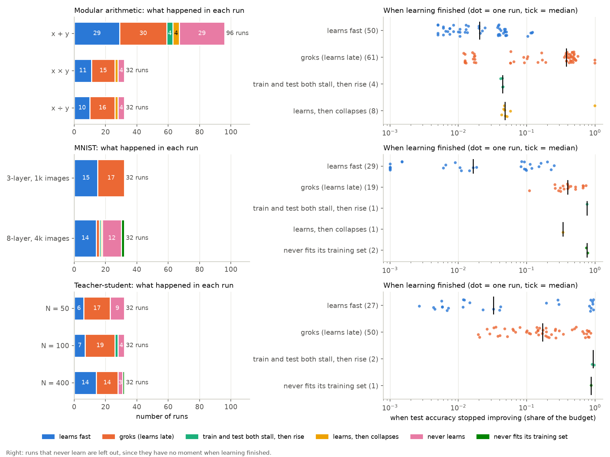

**Figure 1.** Left: outcome counts per task variant. Right: when test accuracy stopped
improving, as a share of the budget (log scale).

**Modular arithmetic (160):** 50 learn fast (median t_ε at 2% of the budget), **61 grok**
(median 38%; a large group at 35–55%), 4 stall then rise, 8 collapse, 37 never learn
(almost all without weight decay). Learners reach 100% test accuracy.

**MNIST (64):** 29 learn fast (median 1.6%), 19 grok (median 40%; 17 of them on the
3-layer network), 1 stalls then rises, 1 collapses, 2 never fit, **12 never learn** (all
8-layer; mostly SGD at learning rate 1e-4). Best test accuracy ~91–93%; grokking here is
a slow creep, not a jump.

**Teacher–student (96):** 27 learn fast (median 3%), **50 grok** (median 17%, spread from
2% to 87% of the budget), 2 stall then rise, 1 never fits, 16 never learn. Best test
accuracy (share of inputs predicted within 0.01) grows with N: medians 0.55, 0.80 and
0.97 for N = 50, 100, 400.

## 6. The score

> **score = accuracy lost + λ × budget wasted**
>
> - accuracy lost = best test accuracy of the run − test accuracy at the stop
> - budget wasted = (stop step − t_ε) / budget, or 0 if the stop is before t_ε
> - a rule that never fires is scored as stopping at the end of the budget

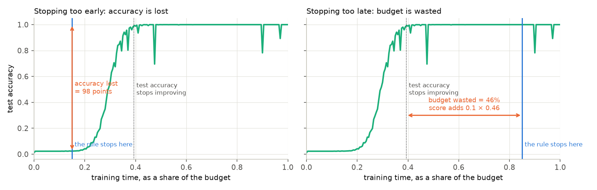

**Figure 2.** One modular grokking run. Stopping before the jump loses almost all the
accuracy; stopping long after it wastes budget.

- **λ, the price of compute:** 0.1 (main: wasting the whole budget = losing 10 accuracy
  points), 0.03 (accuracy first) and 0.3 (compute first). Every rule is re-tuned for each λ.
- Also reported: accuracy lost, budget wasted, **stopped too early** (share of runs stopped
  before t_ε, and how many grokking runs), and how often the rule **never stopped**.
- Training to the end scores 0.07–0.14 at λ = 0.1; a perfect stop scores about 0.01.

## 7. The candidates

| Candidate | Uses test data? | Settings tuned over |
|---|---|---|
| **Never stop** | no | — |
| **Fixed fraction**: stop at 2, 5, 10, 15, 20, 30, 40, 50, 70 or 100% of the budget | no | 10 |
| **N1-A** norm has stopped changing | no | 70 |
| **N1-B** norm has stopped shrinking | no | 70 |
| **N1, tuned pick of A and B**: the best of all 140 settings on the tuning runs | no | 140 |
| **Perfect stop**: exactly at t_ε | **yes** | — (the floor) |

The tuned pick is the honest single answer to "how good is N1": it is chosen by a rule
fixed in advance, not by looking at the held-out results.

## 8. Tuning and testing

For each candidate: compute the average score of every setting on a set of **tuning
runs**, keep the best, and score that one setting on **held-out runs** it never saw.

| Test | Tuning runs | Held-out runs | Question |
|---|---|---|---|
| **A: new seeds** (every task) | seeds 0–1 of every setting | seeds 2–3 of the same settings | new runs of familiar settings? |
| **B, modular** | x + y (96) | x × y and x ÷ y (64) | a new task? |
| **B, MNIST** | 3-layer network (32) | 8-layer network on 4× more data (32) | a new architecture? |
| **B, teacher–student** | N = 50 and 100 (64) | N = 400 (32) | more data, later grokking? |

**Confidence intervals (95%), cluster bootstrap.** The held-out runs are grouped by
setting (2 runs per setting in Test A, 4 in Test B), because seeds of one setting behave
alike. We draw as many settings as there are, with replacement, average the scores of
their runs, repeat 2,000 times, and take the 2.5th and 97.5th percentiles.
**Comparisons are paired:** for "N1 minus the fixed fraction" we compute the difference
on each held-out run first (both rules are scored on the same runs) and bootstrap that.
The verdict is **better** if the paired interval lies below 0, **worse** if above, a
**tie** otherwise. The interval covers the luck of which settings were held out, not the
luck of tuning; with only 8 held-out settings (both Test B splits of MNIST and
teacher–student) it is coarse.

## 9. Results

At λ = 0.1 unless stated.

### 9.1 Overview

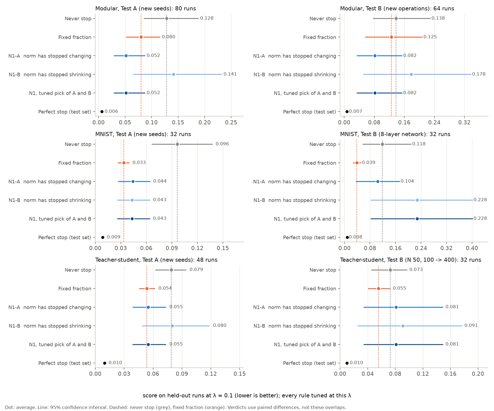

**Figure 5.** Held-out score of every candidate. Dot: average; line: 95% interval.

| | Candidate (tuned setting) | Score | Accuracy lost (pts) | Budget wasted | Stopped too early | Grokkers cut off | Never stopped | vs never stop | vs fixed fraction |
|---|---|---|---|---|---|---|---|---|---|
| **Modular A** | Never stop | 0.128 | 4.5 | 84% | 0% | 0 of 30 | 100% | — | worse |
| | Fixed fraction (50%) | 0.080 | 4.4 | 36% | 9% | 4 of 30 | 0% | better | — |
| | N1-A (= tuned pick) | **0.052** | 2.0 | 32% | 0% | **0 of 30** | 21% | better | tie |
| | N1-B | 0.141 | 12.6 | 15% | 10% | 7 of 30 | 3% | tie | tie |
| **Modular B** | Never stop | 0.138 | 5.6 | 82% | 0% | 0 of 31 | 100% | — | tie |
| | Fixed fraction (40%) | 0.126 | 10.2 | 24% | 25% | **16 of 31** | 0% | tie | — |
| | N1-A (= tuned pick) | 0.082 | 4.0 | 42% | 0% | **0 of 31** | 41% | better | tie |
| | N1-B | 0.178 | 15.9 | 19% | 11% | 7 of 31 | 0% | tie | tie |
| **MNIST A** | Never stop | 0.096 | 2.4 | 72% | 0% | 0 of 10 | 100% | — | worse |
| | Fixed fraction (40%) | 0.034 | 1.4 | 20% | 28% | 5 of 10 | 0% | better | — |
| | N1-A | 0.044 | 2.8 | 16% | 41% | 4 of 10 | 0% | better | tie |
| | N1-B (= tuned pick) | 0.043 | 2.8 | 15% | 41% | 4 of 10 | 0% | better | tie |
| **MNIST B** | Never stop | 0.118 | 4.8 | 70% | 0% | 0 of 2 | 100% | — | worse |
| | Fixed fraction (40%) | 0.039 | 1.8 | 20% | 25% | 0 of 2 | 0% | better | — |
| | N1-A | 0.104 | 9.8 | 5% | 63% | 2 of 2 | 0% | tie | tie |
| | N1-B (= tuned pick) | **0.228** | 20.6 | 22% | 38% | 0 of 2 | 25% | tie | **worse** |
| **Teacher–student A** | Never stop | 0.079 | 1.1 | 68% | 0% | 0 of 26 | 100% | — | worse |
| | Fixed fraction (50%) | 0.054 | 2.6 | 27% | 31% | 6 of 26 | 0% | better | — |
| | N1-A (= tuned pick) | 0.055 | 2.0 | 35% | 15% | 4 of 26 | 40% | better | tie |
| | N1-B | 0.080 | 4.9 | 31% | 27% | 6 of 26 | 31% | tie | tie |
| **Teacher–student B** | Never stop | 0.073 | 0.3 | 70% | 0% | 0 of 14 | 100% | — | tie |
| | Fixed fraction (50%) | 0.056 | 2.6 | 29% | 28% | 1 of 14 | 0% | tie | — |
| | N1-A (= tuned pick) | 0.081 | 5.6 | 24% | 38% | 2 of 14 | 3% | tie | tie |
| | N1-B | 0.091 | 7.7 | 14% | 38% | 2 of 14 | 0% | tie | tie |

Perfect stop scores 0.006–0.010 everywhere.

Every observation below is explained by a few facts about the data, referred to by letter:

- **(F1) Modular: the norm shrinks during the jump and levels off right after it.** At
  three times t_ε the norm is at 0.89 of its value at t_ε (median), and over the last 10%
  of the budget it no longer changes (Figures 3, 4).
- **(F2) MNIST: the norm keeps shrinking long after test accuracy has finished.** On the
  3-layer network it falls to 0.62 of its t_ε value by 3× t_ε; on the 8-layer network to
  0.78 by the end. Accuracy does not change meanwhile (Figure 4).
- **(F3) Teacher–student: the norm drifts down slowly over the whole run,** before and
  after t_ε, with no sharp change at the moment accuracy finishes (Figure 4).
- **(F4) Without weight decay, nothing drives the norm.** With γ = 0 the norm can sit
  nearly still from the very first steps.
- **(F5) Most runs finish learning early in the budget**, so any rule that stops somewhere
  in the middle saves most of the waste; that is what the fixed fraction does.
- **(F6) Stopping a grokking run early costs ~100 points on modular, a few points on
  MNIST and teacher–student**, where the last stretch before t_ε is a slow creep.

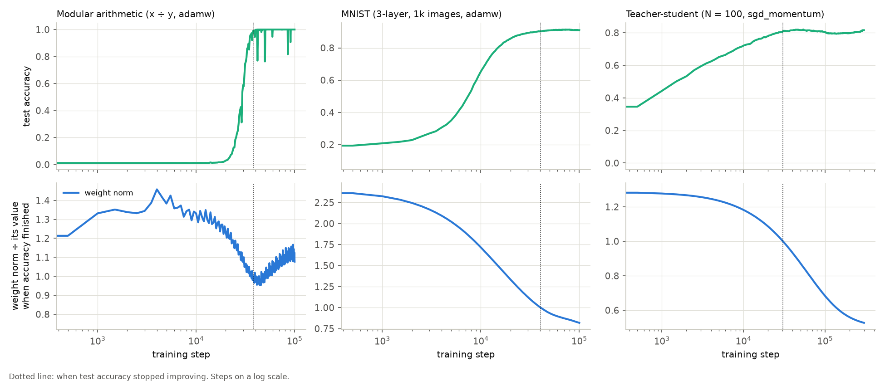

**Figure 3.** One typical grokking run per task: test accuracy (top) and the weight norm
divided by its value when accuracy finished (bottom). Dotted line: t_ε.

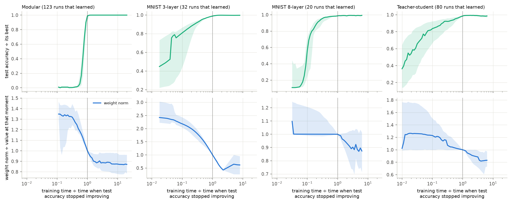

**Figure 4.** Medians over all runs that learned, with each run's time divided by its
t_ε (1 = the moment accuracy finished). Bands: middle half of runs.

### 9.2 Modular: N1 halves the waste and never cuts off a grokker

**Observation.** The tuned N1 (rule A: |change of log‖w‖| ≤ 0.003 over the last 5–10% of
the budget) scores 0.052 on new seeds and 0.082 on new operations, against 0.128 and 0.138
for training to the end (both clearly better). It stopped **no grokking run** before it
generalized; the fixed fraction stopped 4 of 30 and **16 of 31**.

**Why.** By (F1), "the norm is flat" arrives just after the jump, so a strict flatness
threshold cannot fire before the jump (the norm is still falling then) and fires soon
after it. The waste it removes comes from (F5).

**But it ties the tuned fixed fraction.** On new seeds N1 is lower on every large group
of runs (fast learners 0.033 vs 0.049, grokkers 0.036 vs 0.054, never-learners 0.044 vs
0.100, [tables/by_outcome.csv](tables/by_outcome.csv)), but two "stall then rise" runs
where it stops on the stall cost it 0.45 each, and with 40 settings the interval
(−0.070 to +0.015) includes 0.

**What it pays.** N1-A never stops on 21% (new seeds) and 41% (new operations) of runs:
mostly grokking runs trained with AdamW, SGD or SGD + momentum (none with Adam + L2),
whose norm keeps drifting after the jump (in
the AdamW run of Figure 3 it climbs back up), so the strict threshold never holds. On a
run that has already generalized, never stopping costs budget, not accuracy.

**N1-B ("stopped shrinking") is worse.** It fires whenever the norm is not falling, and
on many runs the norm *grows* while the network memorizes, before weight decay takes
over (the median modular run goes from 39 at the start to 57 at t_ε). So N1-B fires on
the plateau: it cut off 7 grokkers in each test (on new seeds, AdamW runs stopped at
11–16k steps that grok at 38–52k).

### 9.3 How robust is "ties the fixed fraction"?

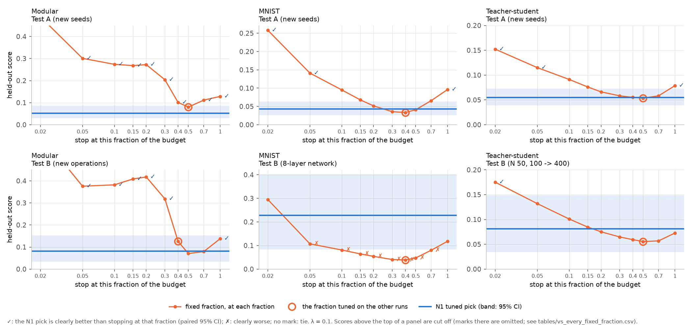

**Figure 7.** Held-out score of stopping at each fraction of the budget (orange) against
the tuned N1 pick (blue line and band). Ring: the fraction chosen on the tuning runs.
✓: N1 clearly better than that fraction; ✗: clearly worse.

- **Modular, new seeds:** N1 is clearly better than **every** fraction except 50%, which
  is the one tuning chose (tie). The fixed fraction only competes when its single number
  happens to be right.
- **Modular, new operations:** the fraction tuned on x + y (40%) lands where many
  x × y, x ÷ y runs are in the middle of their jump (Figure 1: grokkers cluster at
  35–55%), so its score is poor (0.126). Fractions of 50% and 70% would score 0.070 and
  0.080 and tie N1 — but nothing on the x + y runs pointed to them.
- **MNIST and teacher–student, new seeds:** N1 ties every fraction from 10–15% to 70%,
  because the score is flat over that range (F5, F6).
- **MNIST, 8-layer:** N1 is worse than every fraction from 5% to 70% (section 9.5).

**This matters for comparing with the F2 report.** That study checked its rules at
slightly different steps (the first check after 40% of the budget fell at step 41,600,
here at 40,000). Many x × y and x ÷ y runs jump in between, so the same "stop at 40%"
scored 0.090 there and 0.126 here. Comparisons are fair within a report, not across.

### 9.4 Where the rule stops

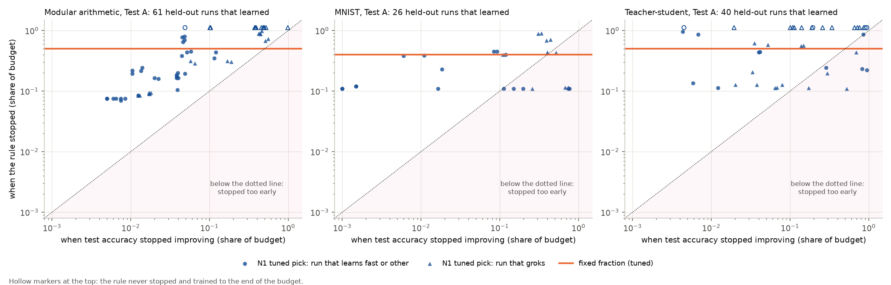

**Figure 8.** Held-out runs of Test A that learned: when test accuracy finished (x) and
when the tuned N1 rule stopped (y). Below the dotted diagonal = too early. Orange line:
the tuned fixed fraction. Triangles: grokking runs. Hollow: never stopped.

- **Modular:** every stop is above the diagonal; the stops rise with t_ε (N1 adapts to
  each run), and late grokkers are caught after their jump.
- **MNIST:** the tuned rule (rule B: the norm shrank by less than 10% over the last 10% of
  the budget) fires as early as it is allowed (at ~11% of the budget) on half the runs,
  because by (F2) it allows a lot of shrinking. It is close to a fixed early stop, and
  stops 41% of runs before t_ε (4 of 10 grokkers) — which by (F6) costs little.
- **Teacher–student:** stops scatter on both sides of the diagonal: by (F3) the norm's
  slow drift says little about when accuracy finishes.

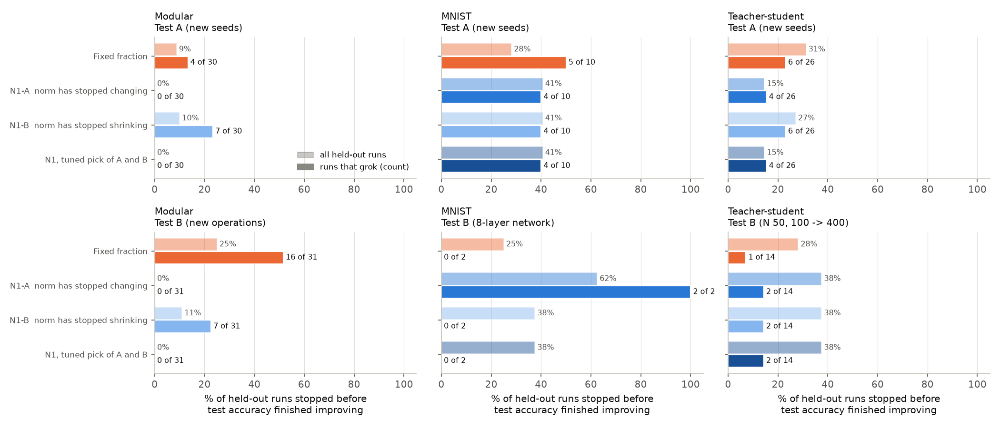

**Figure 9.** Share of held-out runs stopped before test accuracy finished (light) and
the number of grokking runs cut off (dark), for every test.

### 9.5 MNIST 8-layer: N1 fails without weight decay

**Observation.** Tuned on the 3-layer network, N1 picks rule B with a lag of 1% of the
budget in weight-decay units (tolerating shrinkage up to 0.3 of the pure-decay rate). On
the 8-layer network it scores 0.228: higher than training to the end (0.118, though the
interval of that difference includes 0) and clearly worse than every fixed fraction from
5% to 70%. It loses 21 accuracy points on average.

**Why (F4).** All twelve 8-layer runs that it stopped before t_ε have **no weight decay**
(Adam + L2 at γ = 0 with ×8 initial weights; SGD and SGD + momentum at learning rate
1e-4, γ = 0). With γ = 0 the decay units are undefined, the rule falls back to the plain
change, and the norm of these runs barely moves: the rule fires at step 2,000, the
earliest moment it can, long before they learn (t_ε between 11k and 90k steps). The
3-layer tuning runs had no slow-learning γ = 0 setting to warn against this.

**The general lesson:** N1 measures weight decay at work. Where there is no weight decay,
"the norm is flat" means nothing, and a rule built on it must not be used (or must wait
for a minimum time). The same weakness shows on teacher–student N = 400 (section 9.6).

### 9.6 MNIST and teacher–student, new seeds: a tie, for different reasons

- **MNIST:** N1 (0.043) ties the fixed fraction (0.034) and beats never stopping. By (F2)
  the norm's flattening comes long after accuracy finishes, so the tuning chose a loose
  threshold that behaves like an early fixed stop (section 9.4); by (F6), the early stops
  are cheap.
- **Teacher–student:** N1 (0.055) ties the fixed fraction (0.054) and beats never
  stopping. It loses less accuracy (2.0 vs 2.6 points) and cuts off fewer grokkers (4 vs 6
  of 26), but never stops on 40% of runs (F3: the norm still drifts), wasting more.
- **Teacher–student, more data (N = 400):** everything ties, including never stopping.
  N1 stopped 12 of the 32 runs too early: 8 trained **without weight decay** (F4; SGD and
  SGD + momentum at γ = 0, stopped at about 10% of the budget) and 4 very slow SGD runs
  with tiny decay (γ = 1e-4) that only finish learning at 83–94% of the budget. The
  tuning runs (N = 50, 100) had no such slow learners.

### 9.7 Other weightings of compute

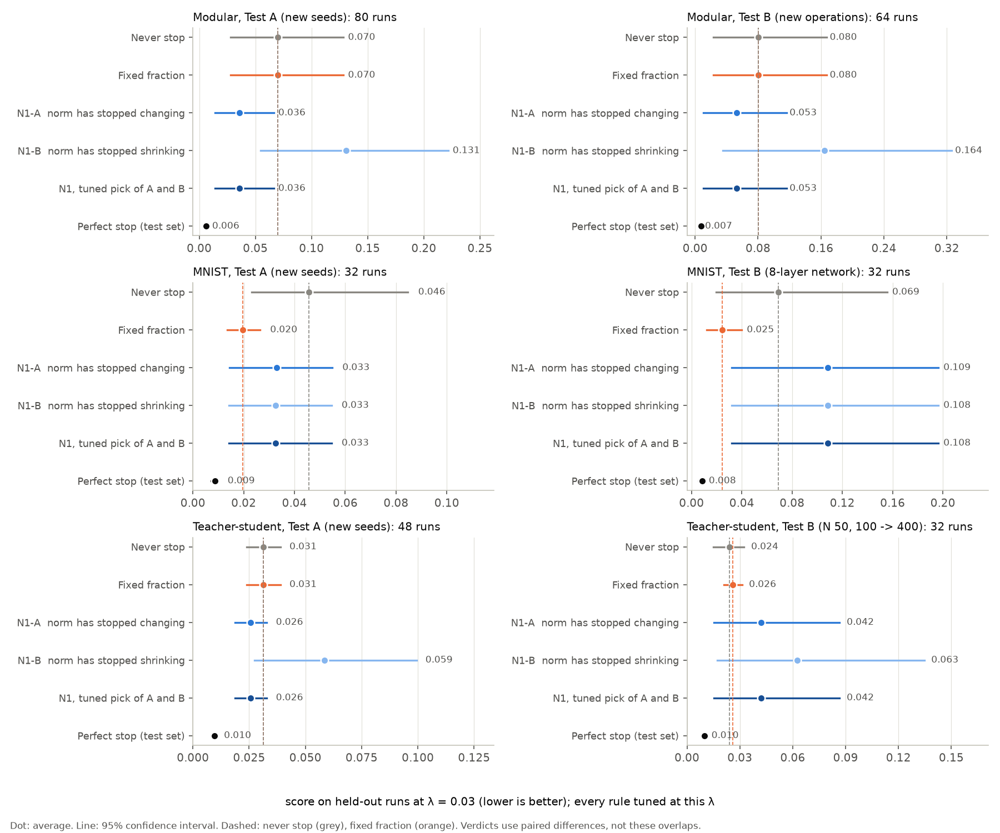

**Figure 6a.** As Figure 5, with every rule re-tuned at λ = 0.03 (accuracy first).

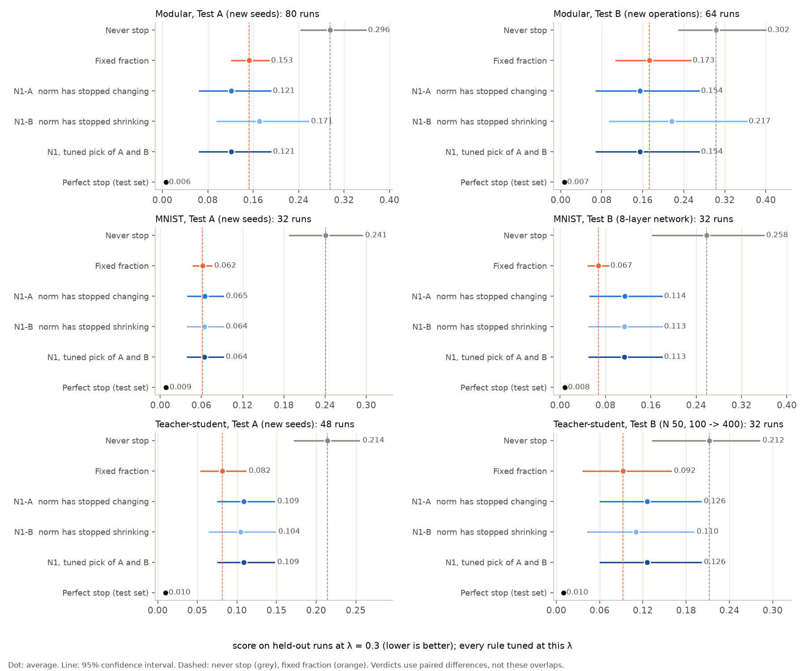

**Figure 6b.** At λ = 0.3 (compute first).

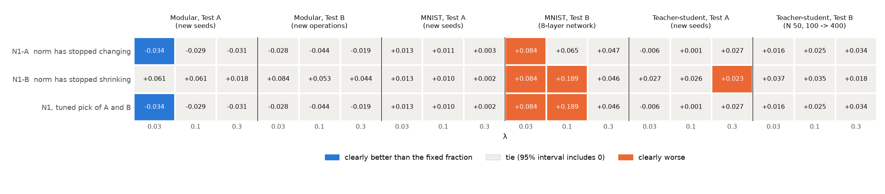

**Figure 10.** N1 minus the fixed fraction, paired, at every λ. Blue: clearly better;
orange: clearly worse; grey: tie.

- **λ = 0.03:** on modular and teacher–student new seeds the tuned fixed fraction
  becomes "never stop" (100%). N1 then wins clearly on modular new seeds (0.036 vs 0.070), because by
  (F1) it stops late enough to be safe; elsewhere it ties, and on the 8-layer MNIST
  network it is again worse (F4).
- **λ = 0.3:** the tuned N1 pick ties the fixed fraction everywhere (rule B alone is
  worse on teacher–student new seeds); on modular N1 still never cuts off a grokker on new
  operations (0 of 31, the fixed fraction 16 of 31).

### 9.8 Does the tuning carry over?

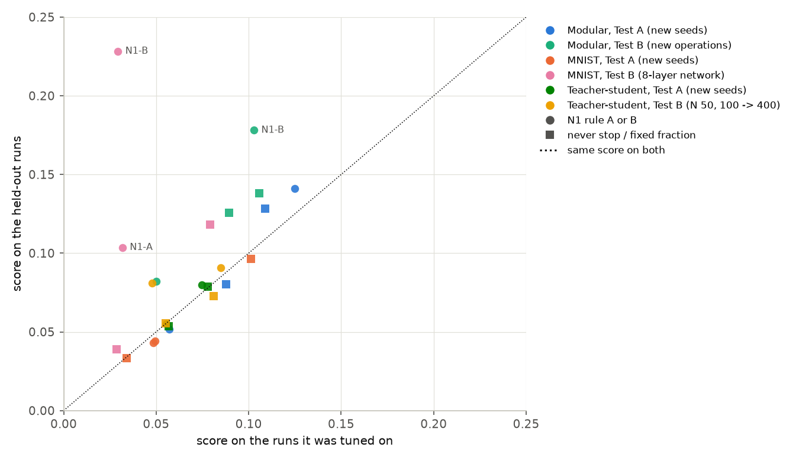

**Figure 11.** Score on the tuning runs (x) against the held-out score (y), per candidate
and test. Above the diagonal: worse on new runs than on the tuning runs.

- On new seeds, points sit near the diagonal: tuning transfers.
- The large misses are N1 moved to a new setting: rule B on the 8-layer network (0.029 →
  0.228, section 9.5) and on new modular operations, and rule A on the 8-layer network.
- The fixed fraction carries over well except on modular new operations (0.089 → 0.126),
  where its one number falls on the grokking jump (section 9.3).

The settings chosen at every λ are in [tables/tuned_settings.csv](tables/tuned_settings.csv).

## 10. Conclusion

1. **On modular arithmetic, N1 is a real, safe stopping signal.** Its tuned rule ("the
   weight norm has not changed by more than 0.3% over the last 5–10% of the budget")
   halves the cost of training to the end on new seeds and new operations, and never
   stopped a grokking run before it generalized. This is the Omnigrok picture at work:
   the norm shrinks through the jump and stops right after it.
2. **On average it ties a tuned fixed fraction of the budget.** On new seeds it beats
   every fraction except the one tuning picked; on new operations it beats the fraction
   tuned on x + y only because that fraction lands on the jump. Its advantages are safety
   and adapting to each run's timing, not a lower average score.
3. **On MNIST and teacher–student, N1 ties the fixed fraction on new seeds** but for weak
   reasons: the norm keeps changing after learning ends (MNIST) or drifts throughout
   (teacher–student), so the tuned rule is either nearly a fixed early stop or rarely
   fires.
4. **N1 must not be used without weight decay.** With γ = 0 the norm can be flat from the
   start, and N1 stops before anything is learned (the 8-layer MNIST failure).
5. **The simple version is the right one:** "stopped changing" (N1-A) with a strict
   threshold beats "stopped shrinking" (N1-B), which also fires on flat plateaus before
   the jump.

---

## Appendix: files and reproduction

| Path | Contents |
|---|---|
| `figures/` | the figures above (05, 06a, 06b: scores at λ = 0.1, 0.03, 0.3) |
| `tables/summary.csv` | every candidate × test × λ: tuned setting, tuning and held-out score with interval, accuracy lost, budget wasted, stopped too early, grokkers cut off, never stopped, paired differences against never stopping and the fixed fraction, verdicts, hindsight-best setting |
| `tables/vs_every_fixed_fraction.csv` | the tuned N1 pick against each fixed fraction, paired (Figure 7) |
| `tables/by_outcome.csv` | held-out score per run outcome for never stop, fixed fraction and the N1 pick |
| `tables/tuned_settings.csv` | the setting chosen for every rule, test and λ |
| `tables/corpus.csv`, `tables/numbers.txt` | the runs by task variant; every number quoted here |
| `scripts/metric_report.py` | `python scripts/metric_report.py <dir> N1` regenerates figures and tables; `<dir>` = a download of HF `advay333/tfs:phase4/metrics_a/` |
| HF `phase4/metrics_a/` | `rows.parquet` (score of every setting of every rule on every run), `series.parquet` (per-check signals and test accuracy), `traces/` (per-run recorded signals), `report_N1/` (the machine summary and `calibration.csv`) |
| `stopping/metric_study.py`, `molab/phase4_metrics_a.py` | the study code and the notebook that ran it (DESIGN.md §13.11) |
