# Stopping training when the representation stops simplifying: the R1 study

*Report of study A, 2026-11-16. It is written to be read with no prior knowledge of the
project. Every number is in [tables/summary.csv](tables/summary.csv) and
[tables/numbers.txt](tables/numbers.txt); `python scripts/metric_report.py <dir> R1`
regenerates all figures and tables from the outputs on HF (`advay333/tfs`, folder
`phase4/metrics_a/`). A companion report covers N1 ([../report_N1/REPORT.md](../report_N1/REPORT.md)).*

## In one paragraph

We want a rule that stops training once a network has finished learning, using only the
training process (no test data), and that does not quit too early on tasks where the
network "groks", i.e. generalizes long after fitting its training data. **R1** watches how
many independent directions the network's hidden layers actually use on the training
data, their *effective rank*. A memorizing network spreads its activity over many
directions; a generalizing one is compact. So R1 stops when the effective rank has
stopped falling. We tuned two versions of the rule on one set of runs and scored them on
320 recorded runs of three tasks they had not been tuned on, against the simplest
competitor: stop at a fixed fraction of the training budget.

- **Modular arithmetic.** On new operations, R1 is clearly better than both training to
  the end and the fixed fraction tuned on the old operation, and it **never stopped a
  grokking run early** (the fixed fraction cut off 16 of 31). The win is over that one
  tuned fraction: R1 ties stopping at 50% or 70% of the budget. On new seeds the version
  tuning chose ties both the fixed fraction and training to the end, because it fires on
  a rank collapse that can happen *before* the jump.
- **MNIST.** R1 ties the fixed fraction on both tests, including the 8-layer network,
  where the tuned N1 and F2 rules were clearly worse.
- **Teacher–student.** The effective rank barely moves (the inputs have only 5
  dimensions), so R1 mostly never fires; it ties the fixed fraction.

---

## 1. What R1 is

**The quantity.** Take one hidden layer and pass the whole training set through the
network. The layer's activations form a matrix H (one row per training example, one column
per unit). Center the columns and take the covariance C = HᵀH / n. Its eigenvalues
λ₁, …, λ_d say how much of the activity lies along each direction. Normalize them to sum
to one, p_k = λ_k / Σλ, and take

> **effective rank = exp( − Σ_k p_k log p_k )**,

the exponential of the spectral entropy (Roy & Vetterli, *The effective rank: a measure of
effective dimensionality*, 2007). It is d if activity is spread equally over all d units
and 1 if it lies along a single direction: it counts the directions the layer actually
uses. It is computed every 500 training steps for every hidden layer.

**Why it is connected to grokking.**
- Weight decay and SGD have a known *low-rank bias*: they remove directions the fit does
  not need (Galanti et al., *SGD and Weight Decay Secretly Minimize the Rank*, 2022).
- A memorizing solution needs many directions (one per training example, roughly);
  a generalizing one needs few (modular arithmetic is solved with a handful of Fourier
  frequencies).
- Fan et al. (*Deep Grokking*, 2024) report the effective rank falling together with
  generalization.

So "the effective rank has stopped falling" should mean "the network has finished
compressing to its generalizing solution". Like the weight norm, it needs only training
data.

**What it cannot see.** It describes the activations, not the test error. It can also
*rise* early in training, while the network spreads out to memorize, before it falls, so
the end of that rise must not be read as settling.

## 2. From the effective rank to a stopping rule

**Requirements.** Causal (only ranks at steps ≤ t), and free of units (the rank's size
depends on the width and the task; its speed of change on the learning rate).

**Step by step.**

1. **Use the logarithm.** The change of log(effective rank) over a lag is the fraction by
   which the rank fell or grew, whatever its size.
2. **Smooth.** Each layer's rank is smoothed by a running median of 3 checks, against
   minibatch jitter.
3. **Choose the lag:** either a share f of the steps so far (t′ = (1 − f)·t; the learning
   rate drops out) or a share c of the budget (t′ = t − c·T).
4. **Choose the layers.** Networks have 2 to 7 hidden layers here. Three options: the
   **mean** rank over hidden layers; the **last** hidden layer (closest to the output,
   where the task's structure should show); or **all** layers must have stopped changing.
5. **Decide what counts as done:** |change| ≤ ε.
6. **Optionally, guard against the early rise (R1-B).** Only allow a stop once the mean
   rank has fallen at least 5% below the highest value it has reached so far, so that the
   flat top of an early rise is not read as settling.
7. **Patience.** The condition must hold at 3 consecutive checks (every 500 steps).

## 3. The variants and their settings

| Knob | Values | Why |
|---|---|---|
| Rule | **R1-A** \|change\| ≤ ε; **R1-B** the same, but only after the mean rank has fallen 5% below its running maximum | step 6 |
| Layers | mean over hidden layers; last hidden layer; every hidden layer must pass (3 options) | step 4 |
| Lag | f·t with f = 10%, 25%, 50%; or c·T with c = 1%, 2%, 5%, 10% (7 options) | step 3 |
| Threshold ε on the change of log rank | 0.001, 0.003, 0.01, 0.03, 0.1 (5 options) | how flat is flat |
| Smoothing, patience | running median of 3; 3 checks (fixed) | against jitter and flukes |

**Settings:** 2 rules × 3 layer choices × 7 lags × 5 thresholds = **210**. Tuning picks one
setting per rule and a **tuned pick** across both.

## 4. The data: 320 recorded training runs

No network was trained for this study: we reused runs from the project's corpus (1,664
runs, trained earlier with full recordings) and picked 320. These are the same runs as in
the N1 report.

### 4.1 The three tasks

| | Modular arithmetic (160 runs) | MNIST digits (64 runs) | Teacher–student (96 runs) |
|---|---|---|---|
| Task | Given a, b in {0, …, 96}, predict (a + b), (a × b) or (a ÷ b) mod 97 (one-hot inputs, 97 classes) | Classify 28 × 28 handwritten digits (10 classes) | Imitate a fixed random "teacher" network: 5 inputs → 5 outputs, a tanh MLP 5-100-100-5 |
| Training set | 30%, 50% or 70% of all pairs (x + y); 50% (x × y, x ÷ y) | 1,000 images (3-layer net) or 4,000 (8-layer net) | N = 50, 100 or 400 random inputs |
| Test set | all remaining pairs | the 10,000 test images | 1,000 random inputs; a prediction counts as correct when its RMS error is below 0.01 |
| Network | MLP, 3 layers × 512, ReLU (2 hidden layers) | MLP, 3 × 200 or 8 × 400, ReLU (2 or 7 hidden layers) | MLP, 3 layers × 100, tanh (2 hidden layers) |
| Loss, batch | cross-entropy, full batch | squared error, batches of 200 | squared error, full batch |
| Budget | 100,000 steps | 100,000 steps | 300,000 steps |

### 4.2 What varies between runs

| | Modular | MNIST | Teacher–student |
|---|---|---|---|
| Optimizer | AdamW, Adam with L2 penalty, SGD, SGD with momentum 0.9 | same four | same four |
| Learning rate | 1e-3 (Adam family), 1 (SGD), 0.3 (SGD + momentum) | 1e-3 (Adam family); 0.01–0.1, or 1e-4 for some 8-layer SGD settings | 3e-4 (Adam family), 0.1 (SGD family) |
| Weight decay | 4 levels per optimizer, from 0 to 1 | 4 levels per optimizer, from 0 to 0.1 | 4 levels per optimizer, from 0 to 1 |
| Initial weight scale | ×1, ×2, ×4 | ×1, ×2, ×4, ×8 | ×0.5, ×1, ×2 |
| Seeds | 4 per setting | 4 per setting | 4 per setting |

Exact values: [tables/corpus.csv](tables/corpus.csv); full grids: `configs/sweeps/phase3_*.yaml`.

### 4.3 How the runs were chosen

- **Whole settings, all 4 seeds.** A setting is one combination of the hyperparameters
  above; we always took all four of its seeds.
- **How many:** modular 40 settings (6 per optimizer for x + y, 2 each for x × y, x ÷ y);
  MNIST 16 (2 per optimizer for each network); teacher–student 24 (2 per optimizer for
  each training-set size).
- **Every behaviour represented:** within each (task variant, optimizer), settings were
  picked in turn from each outcome type seen on seed 0 (fast, grokking, never learning, …).

### 4.4 What was measured

- The eigenvalues of every hidden layer's activation covariance on the full training set
  were recorded during training every 500 steps, so **no replay was needed**: each run's
  recordings were downloaded and the rules computed from them. All 320 runs were
  processed without failure.
- The rules are checked every 500 steps (200 checks per modular or MNIST run, 600 per
  teacher–student run). Test accuracy is used **only** to score the stops.

## 5. What happened in these runs

Each run is labelled by what its test accuracy did. The checks are applied in this order:

| Outcome | Rule |
|---|---|
| never learns | best test accuracy below 50% |
| learns, then collapses | final test accuracy more than 10 points below its best |
| never fits its training set | training accuracy never reaches 99% |
| groks (learns late) | test accuracy finishes improving at least 10× later than the training set was fit, and at least 1,000 steps later |
| train and test both stall, then rise | fitting takes ≥ 2,000 steps and test accuracy finishes within 2× of that |
| learns fast | everything else |

"Finishes improving" means test accuracy first comes within 1 point of its best; we call
this moment **t_ε**.

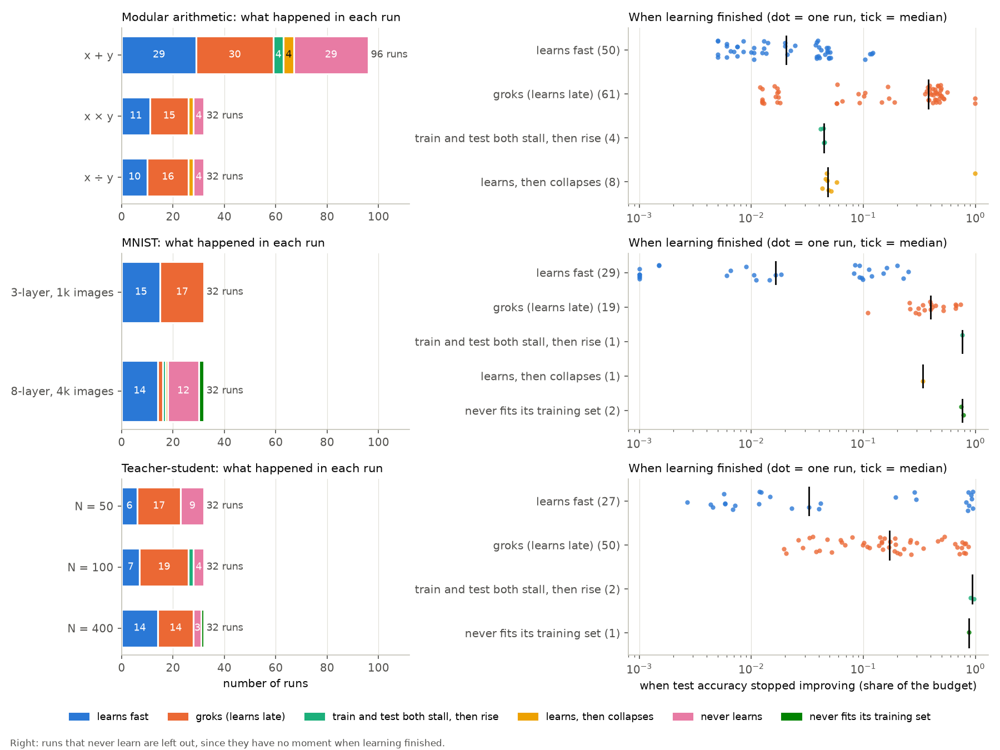

**Figure 1.** Left: outcome counts per task variant. Right: when test accuracy stopped
improving, as a share of the budget (log scale).

**Modular arithmetic (160):** 50 learn fast (median t_ε at 2% of the budget), **61 grok**
(median 38%; a large group at 35–55%), 4 stall then rise, 8 collapse, 37 never learn
(almost all without weight decay). Learners reach 100% test accuracy.

**MNIST (64):** 29 learn fast (median 1.6%), 19 grok (median 40%; 17 of them on the
3-layer network), 1 stalls then rises, 1 collapses, 2 never fit, **12 never learn** (all
8-layer; mostly SGD at learning rate 1e-4). Best test accuracy ~91–93%; grokking here is
a slow creep, not a jump.

**Teacher–student (96):** 27 learn fast (median 3%), **50 grok** (median 17%, spread from
2% to 87% of the budget), 2 stall then rise, 1 never fits, 16 never learn. Best test
accuracy (share of inputs predicted within 0.01) grows with N: medians 0.55, 0.80 and
0.97 for N = 50, 100, 400.

## 6. The score

> **score = accuracy lost + λ × budget wasted**
>
> - accuracy lost = best test accuracy of the run − test accuracy at the stop
> - budget wasted = (stop step − t_ε) / budget, or 0 if the stop is before t_ε
> - a rule that never fires is scored as stopping at the end of the budget

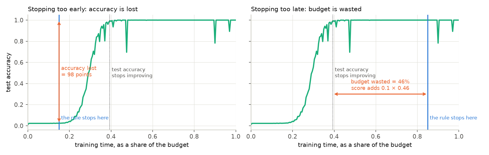

**Figure 2.** One modular grokking run. Stopping before the jump loses almost all the
accuracy; stopping long after it wastes budget.

- **λ, the price of compute:** 0.1 (main: wasting the whole budget = losing 10 accuracy
  points), 0.03 (accuracy first) and 0.3 (compute first). Every rule is re-tuned for each λ.
- Also reported: accuracy lost, budget wasted, **stopped too early** (share of runs stopped
  before t_ε, and how many grokking runs), and how often the rule **never stopped**.
- Training to the end scores 0.07–0.14 at λ = 0.1; a perfect stop scores about 0.01.

## 7. The candidates

| Candidate | Uses test data? | Settings tuned over |
|---|---|---|
| **Never stop** | no | — |
| **Fixed fraction**: stop at 2, 5, 10, 15, 20, 30, 40, 50, 70 or 100% of the budget | no | 10 |
| **R1-A** rank has stopped changing | no | 105 |
| **R1-B** the same, after the rank has fallen 5% | no | 105 |
| **R1, tuned pick of A and B**: the best of all 210 settings on the tuning runs | no | 210 |
| **Perfect stop**: exactly at t_ε | **yes** | — (the floor) |

The tuned pick is the honest single answer to "how good is R1": it is chosen by a rule
fixed in advance, not by looking at the held-out results.

## 8. Tuning and testing

For each candidate: compute the average score of every setting on a set of **tuning
runs**, keep the best, and score that one setting on **held-out runs** it never saw.

| Test | Tuning runs | Held-out runs | Question |
|---|---|---|---|
| **A: new seeds** (every task) | seeds 1–2 of every setting | seeds 3–4 of the same settings | new runs of familiar settings? |
| **B, modular** | x + y (96) | x × y and x ÷ y (64) | a new task? |
| **B, MNIST** | 3-layer network (32) | 8-layer network on 4× more data (32) | a new architecture? |
| **B, teacher–student** | N = 50 and 100 (64) | N = 400 (32) | more data? |

**Confidence intervals (95%), cluster bootstrap.** The held-out runs are grouped by
setting (2 runs per setting in Test A, 4 in Test B), because seeds of one setting behave
alike. We draw as many settings as there are, with replacement, average the scores of
their runs, repeat 2,000 times, and take the 2.5th and 97.5th percentiles.
**Comparisons are paired:** for "R1 minus the fixed fraction" we compute the difference
on each held-out run first and bootstrap that. The verdict is **better** if the paired
interval lies below 0, **worse** if above, a **tie** otherwise. The interval covers the
luck of which settings were held out, not the luck of tuning; with only 8 held-out
settings (MNIST and teacher–student Test B) it is coarse.

## 9. Results

At λ = 0.1 unless stated.

### 9.1 Overview

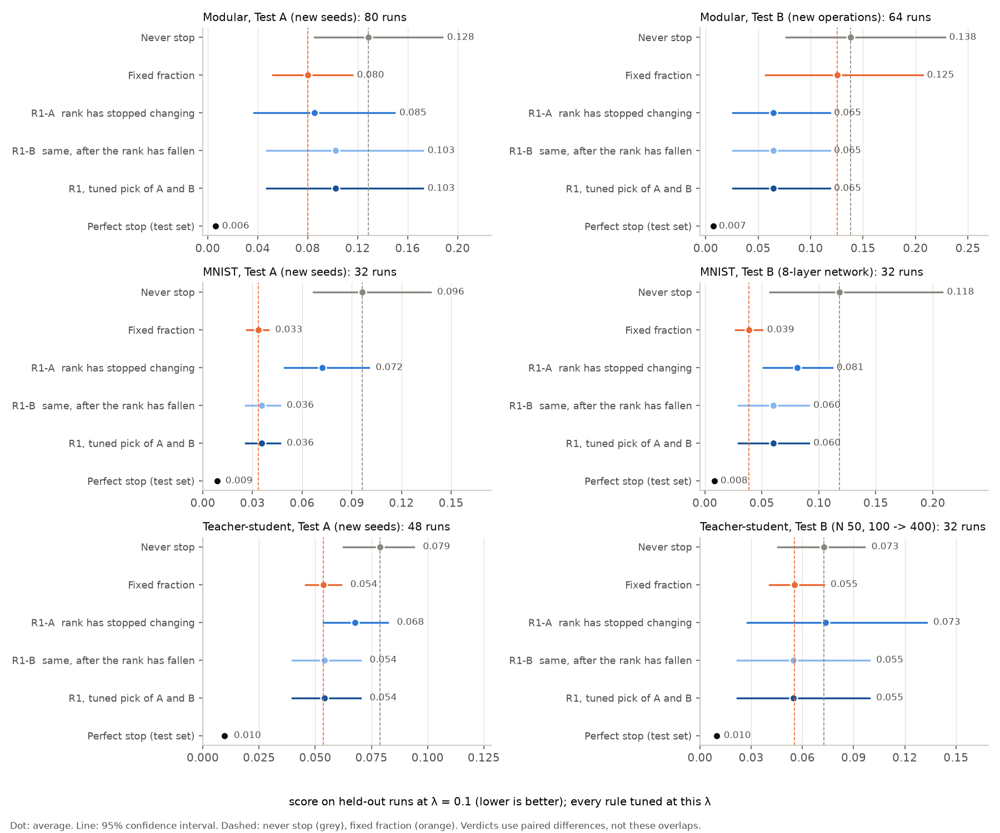

**Figure 5.** Held-out score of every candidate. Dot: average; line: 95% interval.

| | Candidate (tuned setting) | Score | Accuracy lost (pts) | Budget wasted | Stopped too early | Grokkers cut off | Never stopped | vs never stop | vs fixed fraction |
|---|---|---|---|---|---|---|---|---|---|
| **Modular A** | Never stop | 0.128 | 4.5 | 84% | 0% | 0 of 30 | 100% | — | worse |
| | Fixed fraction (50%) | 0.080 | 4.4 | 36% | 9% | 4 of 30 | 0% | better | — |
| | R1-A | 0.085 | 5.2 | 33% | 1% | 1 of 30 | 28% | better | tie |
| | R1-B (= tuned pick) | 0.103 | 8.3 | 20% | 5% | 3 of 30 | 5% | tie | tie |
| **Modular B** | Never stop | 0.138 | 5.6 | 82% | 0% | 0 of 31 | 100% | — | tie |
| | Fixed fraction (40%) | 0.126 | 10.2 | 24% | 25% | **16 of 31** | 0% | tie | — |
| | R1-A (= tuned pick) | **0.065** | 3.1 | 33% | 0% | **0 of 31** | 25% | better | **better** |
| | R1-B | 0.065 | 3.1 | 33% | 0% | 0 of 31 | 25% | better | better |
| **MNIST A** | Never stop | 0.096 | 2.4 | 72% | 0% | 0 of 10 | 100% | — | worse |
| | Fixed fraction (40%) | 0.034 | 1.4 | 20% | 28% | 5 of 10 | 0% | better | — |
| | R1-A | 0.072 | 3.6 | 36% | 22% | 2 of 10 | 28% | tie | worse |
| | R1-B (= tuned pick) | 0.036 | 1.5 | 21% | 25% | 5 of 10 | 16% | better | tie |
| **MNIST B** | Never stop | 0.118 | 4.8 | 70% | 0% | 0 of 2 | 100% | — | worse |
| | Fixed fraction (40%) | 0.039 | 1.8 | 20% | 25% | 0 of 2 | 0% | better | — |
| | R1-A | 0.081 | 5.4 | 27% | 38% | 0 of 2 | 13% | tie | worse |
| | R1-B (= tuned pick) | 0.060 | 4.3 | 17% | 47% | 2 of 2 | 25% | tie | tie |
| **Teacher–student A** | Never stop | 0.079 | 1.1 | 68% | 0% | 0 of 26 | 100% | — | worse |
| | Fixed fraction (50%) | 0.054 | 2.6 | 27% | 31% | 6 of 26 | 0% | better | — |
| | R1-A | 0.068 | 2.3 | 45% | 15% | 3 of 26 | 46% | tie | tie |
| | R1-B (= tuned pick) | 0.054 | 1.3 | 41% | 4% | 1 of 26 | 60% | better | tie |
| **Teacher–student B** | Never stop | 0.073 | 0.3 | 70% | 0% | 0 of 14 | 100% | — | tie |
| | Fixed fraction (50%) | 0.056 | 2.6 | 29% | 28% | 1 of 14 | 0% | tie | — |
| | R1-A | 0.073 | 5.7 | 16% | 38% | 2 of 14 | 0% | tie | tie |
| | R1-B (= tuned pick) | 0.055 | 2.6 | 28% | 13% | 0 of 14 | 38% | tie | tie |

Perfect stop scores 0.006–0.010 everywhere. On modular new seeds, R1-A scores better
than the tuned pick (0.085 vs 0.103), but tuning could not tell them apart (0.054 each on
the tuning runs) and picked R1-B; the table reports what tuning chose.

Every observation below is explained by a few facts about the data, referred to by letter:

- **(F1) Modular: the rank halves through the jump and settles soon after it.** At 3×
  t_ε the mean rank is at 0.46 of its value at t_ε (median), and over the last 10% of
  the budget it changes by under 1% (Figures 3, 4).
- **(F2) Modular: the last hidden layer can collapse *before* the jump.** In many runs its
  rank falls several-fold at the end of memorization, long before test accuracy moves,
  and then sits flat through the plateau (Figure 3 left, Figure 4 left: the last layer
  starts at ~5× its value at t_ε).
- **(F3) MNIST: the rank first rises, then falls through t_ε and keeps falling after
  it.** It rises early in 75% (3-layer) and 90% (8-layer) of runs; after t_ε it falls to
  0.54 (3-layer) and 0.81 (8-layer) of its t_ε value by 3× t_ε.
- **(F4) Teacher–student: the rank barely moves.** The inputs have 5 dimensions, so the
  hidden layers use about 5 directions from start to finish (median mean rank 5.6 at the
  start, 5.2 at t_ε, 5.1 at the end, out of 100 units); it changes by a few percent.
- **(F5) Most runs finish learning early in the budget**, so any rule that stops somewhere
  in the middle saves most of the waste; that is what the fixed fraction does.
- **(F6) Stopping a grokking run early costs ~100 points on modular, a few points on
  MNIST and teacher–student**, where the last stretch before t_ε is a slow creep.

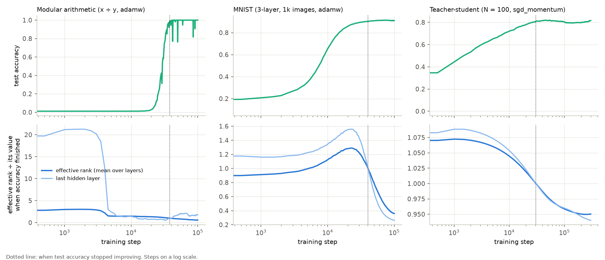

**Figure 3.** One typical grokking run per task: test accuracy (top), and the effective
rank divided by its value when accuracy finished (bottom; dark: mean over hidden layers,
light: last hidden layer). Dotted line: t_ε.

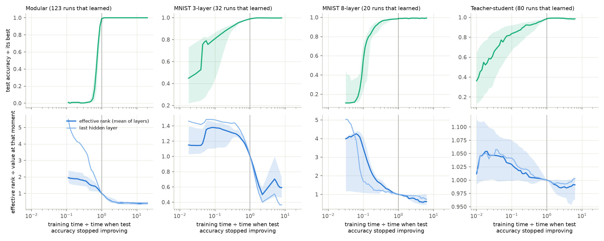

**Figure 4.** Medians over all runs that learned, with each run's time divided by its
t_ε. Bands: middle half of runs (mean rank).

### 9.2 Modular, new operations: R1 beats the tuned fixed fraction, and cuts off no grokker

**Observation.** Tuned on x + y, R1 picks the last hidden layer and stops when its rank
changed by at most 0.3% over the last 2% of the budget. On x × y and x ÷ y it scores 0.065,
against 0.126 for the fixed fraction tuned on x + y (clearly better, paired interval
−0.122 to −0.012) and 0.138 for training to the end (clearly better). It stopped no run
too early; the fixed fraction cut off 16 of 31 grokking runs.

**Why.** By (F1), the rank settles shortly after the jump, so a strict flatness threshold
fires just after it; each run is stopped at its own time. The fixed fraction tuned on x + y
stops at 40%, which is where many x × y and x ÷ y runs are in the middle of their jump
(Figure 1).

**How far the win goes.**

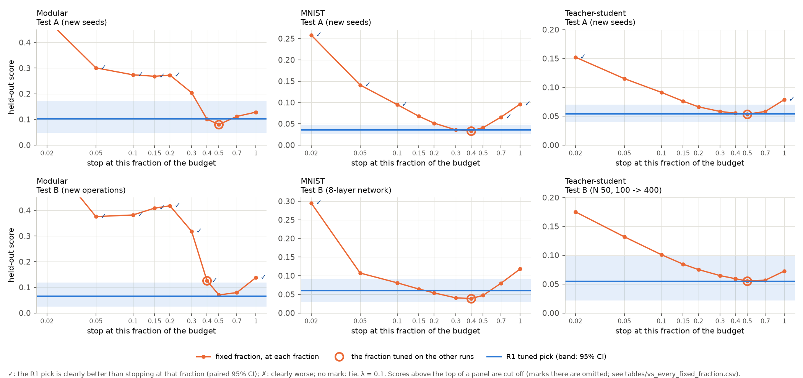

**Figure 7.** Held-out score of stopping at each fraction of the budget (orange) against
the tuned R1 pick (blue line and band). Ring: the fraction chosen on the tuning runs.
✓: R1 clearly better than that fraction.

On new operations R1 is clearly better than every fraction from 2% to 40% and than 100%,
but **ties 50% and 70%** (0.070 and 0.080). A fraction that suited the new operations would
have done as well — but nothing on the x + y runs pointed to it. R1 needs no such luck.

**What it pays.** It never stops on 25% of runs, mostly grokking runs (13 of 31) whose rank
keeps drifting slowly after the jump. That costs budget, not accuracy.

**Comparing with the F2 report.** That study checked its rules at slightly different steps
(the first check after 40% of the budget fell at step 41,600; here at 40,000), and many
x × y, x ÷ y runs jump in between, so the same "stop at 40%" scored 0.090 there, 0.126
here. Compare numbers within a report, not across reports.

### 9.3 Modular, new seeds: a tie, because the rank can collapse before the jump

**Observation.** The tuned pick (R1-B: last layer, change ≤ 1% over 2% of the budget, after
a 5% fall) scores 0.103: a tie with the fixed fraction (0.080) and with training to the
end (0.128). It cut off 3 of 30 grokking runs and lost 8.1 points on grokkers; two "stall
then rise" runs, stopped on the stall, cost 0.86 each.

**Why (F2).** The last layer's rank often collapses at the end of memorization, well
before the jump, and then sits flat on the plateau. A rule that watches the last layer
sees "fallen and flat" and stops on the plateau. R1-A, which waits for a much smaller
change (0.3% over 5% of the budget), is safer (1 of 30 grokkers) and scores 0.085, but it
too only ties the fixed fraction. On new operations the tuned rule's threshold (0.3%) was
strict enough to ride out the plateau.

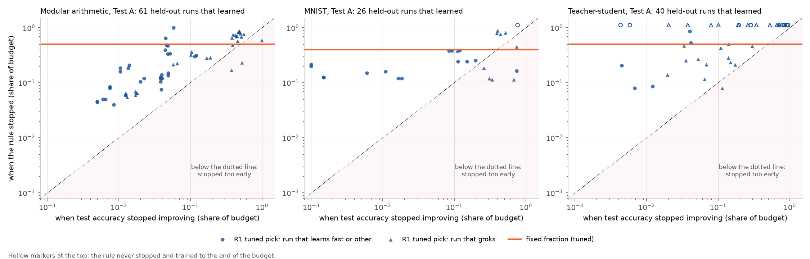

**Figure 8.** Held-out runs of Test A that learned: when test accuracy finished (x) and
when the tuned R1 rule stopped (y). Below the dotted diagonal = too early. Orange line: the
tuned fixed fraction. Triangles: grokking runs; hollow: never stopped.

On modular (left) the stops rise with t_ε, but a few late grokkers (triangles at t_ε ≈
40–50% of the budget) are stopped at 15–25%, on their plateau.

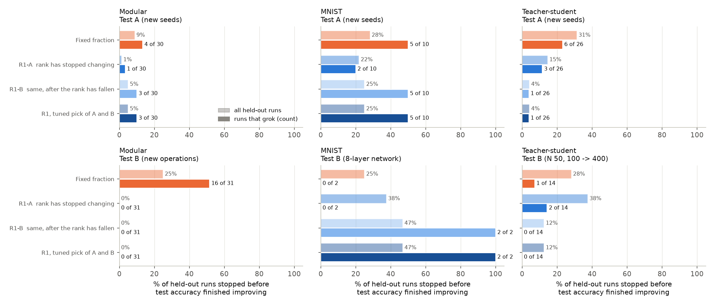

**Figure 9.** Share of held-out runs stopped before test accuracy finished (light) and the
number of grokking runs cut off (dark), for every test.

### 9.4 MNIST: R1 ties the fixed fraction on both tests

**Observation.** On new seeds the tuned pick (R1-B: last layer, change ≤ 10% over 10% of
the budget, after a 5% fall) scores 0.036 against 0.034 (tie) and clearly beats training
to the end. It ties every fixed fraction from 15% to 50% (Figure 7). On the 8-layer
network it scores 0.060 against 0.039, again a tie, where the tuned picks of N1 and F2 were
clearly worse.

**Why (F3).** The rank keeps falling after accuracy finishes, so a strict rule would wait
far too long; tuning chose a loose threshold (10% per 10% of the budget) that fires once
the steep part of the fall is over. That lands near t_ε for many runs (Figure 8 middle),
with early stops that by (F6) are cheap: 25% of runs and half the grokkers are stopped
before t_ε, at a cost of 1.5 points on average. The guard matters: R1-A without it scores
0.072 and is clearly worse than the fixed fraction, because without the guard the flat top
of the early rise (F3) counts as settled.

On the 8-layer network the same rule stops 47% of runs too early (including both grokking
runs), but they lose only 4.3 points on average, so the score still ties.

### 9.5 Teacher–student: R1 has nothing to measure

**Observation.** The tuned pick (R1-B with an extremely strict threshold: change ≤ 0.1%
over half the run, after a 5% fall) ties the fixed fraction on new seeds (0.054 vs 0.054)
and beats training to the end. But it **never stops on 60% of the runs**; it scores well
because when it does stop it is safe (1 of 26 grokkers cut off, 1.3 points lost). On
N = 400 it ties everything, including training to the end.

**Why (F4).** The inputs have 5 dimensions, so the hidden layers' activity lies in about 5
directions from the start; the rank moves by a few percent over the whole run and the 5%
guard is often never met. R1 here is close to "never stop", made usable only by a guard
that rarely opens. This is a structural limit, not a tuning problem: R1 can only see
compression where there is room to compress.

### 9.6 Other weightings of compute

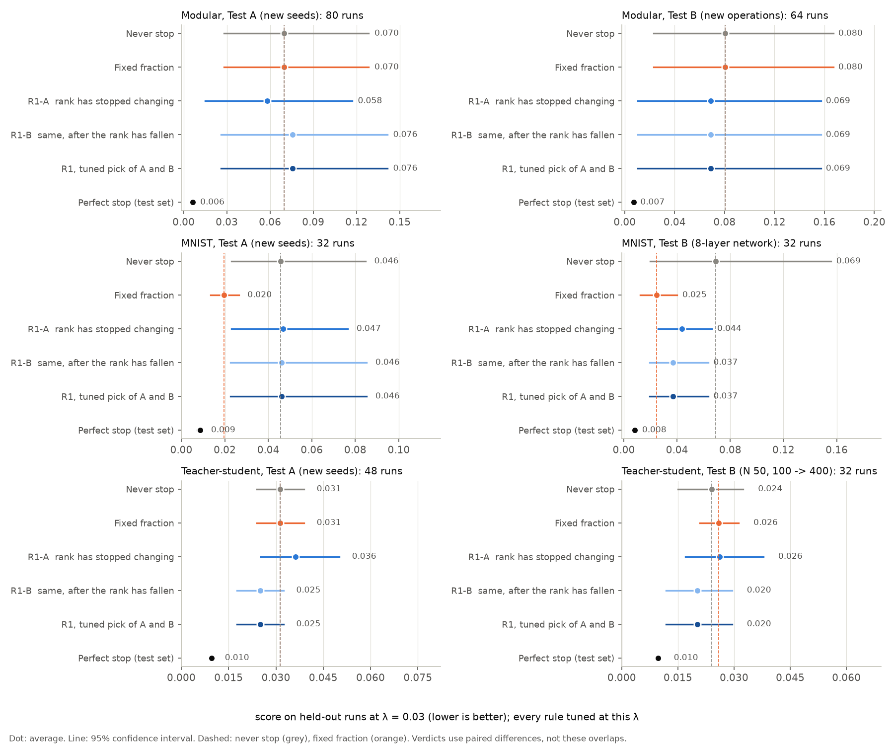

**Figure 6a.** As Figure 5, with every rule re-tuned at λ = 0.03 (accuracy first).

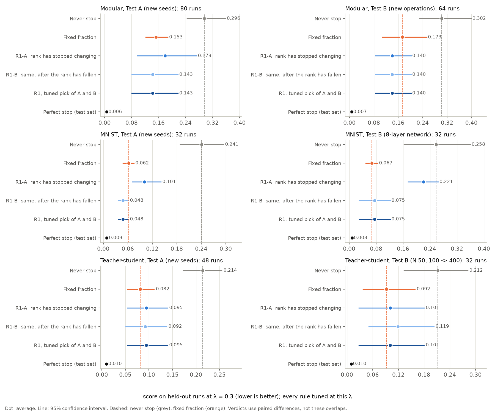

**Figure 6b.** At λ = 0.3 (compute first).

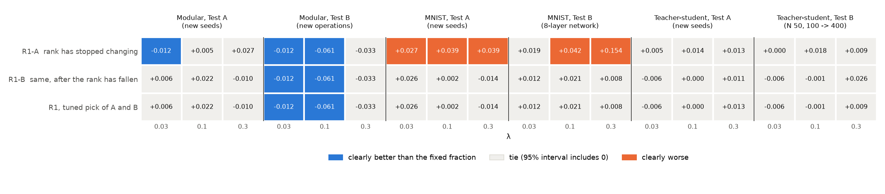

**Figure 10.** R1 minus the fixed fraction, paired, at every λ. Blue: clearly better;
orange: clearly worse; grey: tie.

- **λ = 0.03:** on modular the tuned fixed fraction becomes "never stop". R1-A beats it on
  both tests (0.058 vs 0.070, 0.069 vs 0.080) and never cuts off a grokker; the tuned pick
  wins on new operations and ties on new seeds (tuning chose R1-B there again). MNIST and
  teacher–student tie; R1-A alone is worse on MNIST new seeds.
- **λ = 0.3:** the tuned pick ties the fixed fraction everywhere. On modular new
  operations it still cuts off only 1 of 31 grokkers (the fixed fraction 16). On MNIST
  new seeds both cut off most grokkers (9 and 8 of 10): when compute is expensive, every
  rule stops early, and on MNIST that is cheap (F6). R1-A alone is clearly worse on MNIST
  (both tests).

### 9.7 Does the tuning carry over?

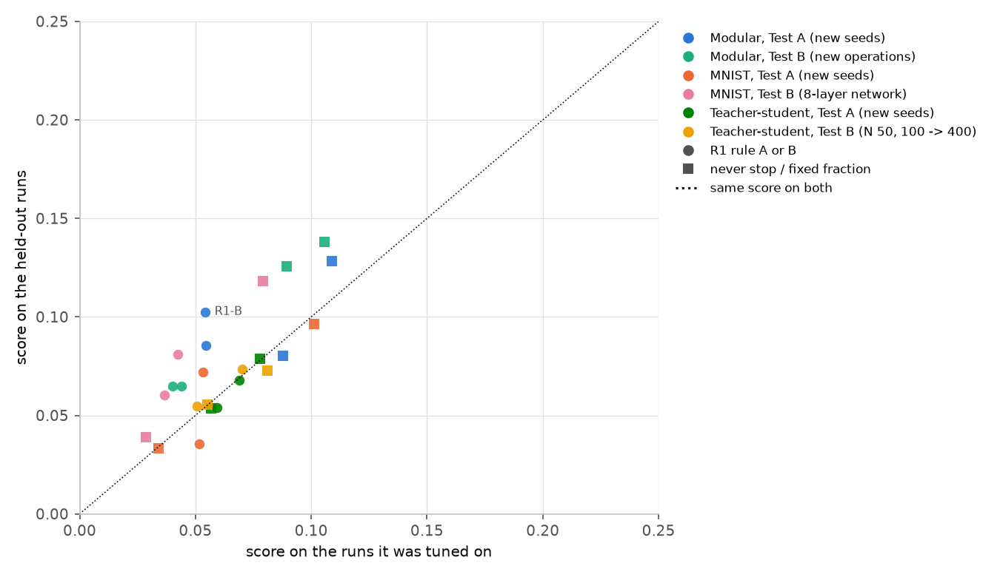

**Figure 11.** Score on the tuning runs (x) against the held-out score (y). Above the
diagonal: worse on new runs than on the tuning runs.

- Most points lie a little above the diagonal: the expected optimism of picking the best
  of 105 settings.
- The largest gaps are on modular new seeds (0.054 → 0.085 for R1-A, → 0.103 for R1-B):
  with 80 tuning runs, the plateau-collapse runs of (F2) are too few to steer tuning away
  from the last-layer rule. R1-A on the 8-layer MNIST network comes next (0.042 → 0.081).
- The fixed fraction carries over well except on modular new operations (0.089 → 0.126),
  where its one number falls on the grokking jump.

The settings chosen at every λ are in [tables/tuned_settings.csv](tables/tuned_settings.csv).

## 10. Conclusion

1. **On modular arithmetic, R1 adapts to each run's timing.** On new operations its tuned
   rule (the last hidden layer's effective rank has changed by at most 0.3% over 2% of the
   budget) halves the cost of training to the end, beats the fixed fraction tuned on the
   old operation, and cut off no grokking run. A fixed fraction that happened to suit the
   new operations (50–70%) would tie it.
2. **It is not reliably safe.** The last layer's rank can collapse at the end of
   memorization, before the jump, and look settled on the plateau; on new seeds the
   version tuning chose cut off 3 of 30 grokking runs and only tied training to the end.
   A stricter threshold or the mean over layers avoids this at the cost of later stops.
3. **On MNIST R1 ties the fixed fraction on both tests**, including the 8-layer network
   where N1 and F2 failed; but this rests on a loose threshold and on early stops being
   cheap on MNIST, not on the rank marking the end of learning (it keeps falling after).
4. **On teacher–student, R1 has nothing to measure**: with 5-dimensional inputs the
   representation is low-rank from the start.
5. **The guard against the early rise is necessary on MNIST** (without it R1 is clearly
   worse than the fixed fraction), and harmless elsewhere.

---

## Appendix: files and reproduction

| Path | Contents |
|---|---|
| `figures/` | the figures above (05, 06a, 06b: scores at λ = 0.1, 0.03, 0.3) |
| `tables/summary.csv` | every candidate × test × λ: tuned setting, tuning and held-out score with interval, accuracy lost, budget wasted, stopped too early, grokkers cut off, never stopped, paired differences against never stopping and the fixed fraction, verdicts, hindsight-best setting |
| `tables/vs_every_fixed_fraction.csv` | the tuned R1 pick against each fixed fraction, paired (Figure 7) |
| `tables/by_outcome.csv` | held-out score per run outcome for never stop, fixed fraction and the R1 pick |
| `tables/tuned_settings.csv` | the setting chosen for every rule, test and λ |
| `tables/corpus.csv`, `tables/numbers.txt` | the runs by task variant; every number quoted here |
| `scripts/metric_report.py` | `python scripts/metric_report.py <dir> R1` regenerates figures and tables; `<dir>` = a download of HF `advay333/tfs:phase4/metrics_a/` |
| HF `phase4/metrics_a/` | `rows.parquet` (score of every setting of every rule on every run), `series.parquet` (per-check signals and test accuracy), `traces/` (per-run per-layer effective ranks), `report_R1/` (the machine summary and `calibration.csv`) |
| `stopping/metric_study.py`, `molab/phase4_metrics_a.py` | the study code and the notebook that ran it (DESIGN.md §13.11) |
